<div align="center">

# doctor_toolkit

**Open-source modding toolkit for the games of the EARS engine
(EA Redwood Shores / Visceral Games), written in Rust.**

First supported game: **The Godfather II (PC)**.

[](https://github.com/Darkildo/doctor_toolkit/actions/workflows/ci.yml)
[](https://github.com/Darkildo/doctor_toolkit/releases)
[](LICENSE)

[](https://discord.gg/MatbKKdFR)

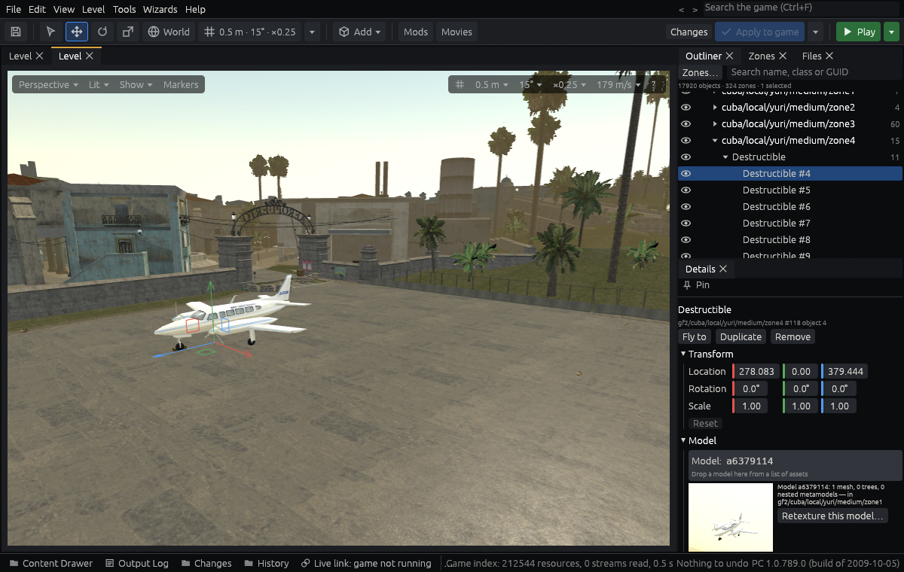

</div>

doctor_toolkit reads, edits and writes the files of the game: streams and
their resources, models and animations, textures, sounds and movies, text,
dialogues, cut-scenes and the game logic, and puts the changes back into the
game safely. It comes as a graphical editor, a command line tool, a Python
module and a Blender add-on. Every format is checked against the installed
game (`docs/analysis/`), and edits go through a workspace with undo, so the
original files are never lost.

## Highlights

- **An editor laid out like a game engine:** a main toolbar with gizmo
  modes, axes and snapping, a status bar with drawers (Content Drawer on
  `Ctrl+Space`), ready layouts for levels and resources and your own named
  layouts; every panel can be docked, split, closed or made a drawer.
- **Editor for everything in the game files:** browse 212,000+ resources of
  2,300 streams, search by name, hash or text, see what uses what.
- **Models and characters:** view with the game's shaders, export and import
  glTF, FBX, OBJ and USD (skinned, with materials), assemble characters from
  their parts, make new outfits.
- **Levels:** the cities in 3D with every object, move, duplicate and add
  objects, start the game right there.
- **Game logic:** the message graph of missions and a run of it without the
  game, visual scripts in the style of Blueprints, Lua scripts, dialogue
  trees, cut-scenes with a timeline.
- **Media:** VP6 movie player and encoder, sound banks and streamed sounds,
  textures to and from DDS and PNG, interface text in every language.
- **Safe changes:** a workspace with undo, redo and compare; mods as packages
  that players install and remove, with dependencies, editions and a load
  order that sorts itself; integrity checks; atomic writes.
- **Play and debug:** start the game from the editor straight into a city or
  at a point, see it in an editor tab (with DXVK under Wine), and talk to the
  running game through a live link: player, camera, objects, teleport,
  messages, Lua, time of day, money, story variables, loading and unloading
  streams; breakpoints on messages, pause and step, the logic graph
  lighting up as messages go. Mods and the workspace can be played without
  writing anything into the game folder: the live module hands the game the
  changed files (`doctor_live.asi` comes with the release).
- **Graphics patch:** the graphics module `doctor_render.asi` fixes the
  time of day, unlocks the game's 30 fps vsync, limits frames without a busy
  core, widens the field of view, adds FXAA and sharpening, and "Play" can
  start the game Large Address Aware — all without writing into the game.
- **Native mods:** the platform module `doctor_platform.asi` lets a mod's
  DLL add new classes of level objects, new Lua functions, listeners and
  hooks, with an SDK for Rust and C and an example
  (`examples/native-class`, `docs/analysis/asi-platform.md`). Such a mod
  travels as one mod file; the mod manager installs its code only after
  the player has seen the files and their hashes and agreed, only into the
  edition 1.0.789.0, and takes it away with the mod (`docs/mods.md` §1.6).
- **AI assistants:** `doctor-toolkit mcp` lets Claude Code, Claude Desktop or
  any MCP client search the game, read resources as JSON and follow the
  logic of missions; with flags it also edits through the workspace (each
  edit undoable, with its diff), builds mods, runs the game off-screen with
  screenshots and acts in it over the live link.

## Screenshots

| | |
|:---:|:---:|
| 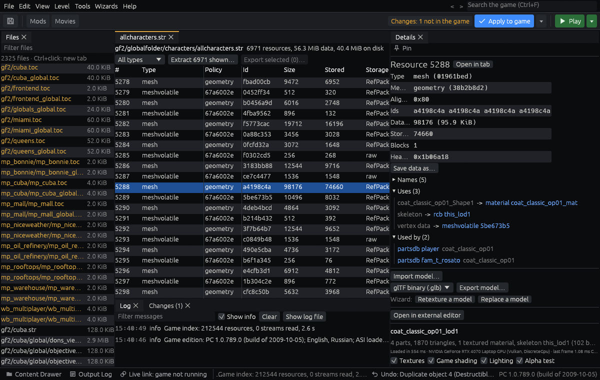<br>**Resources**: files, a stream, details of a model | 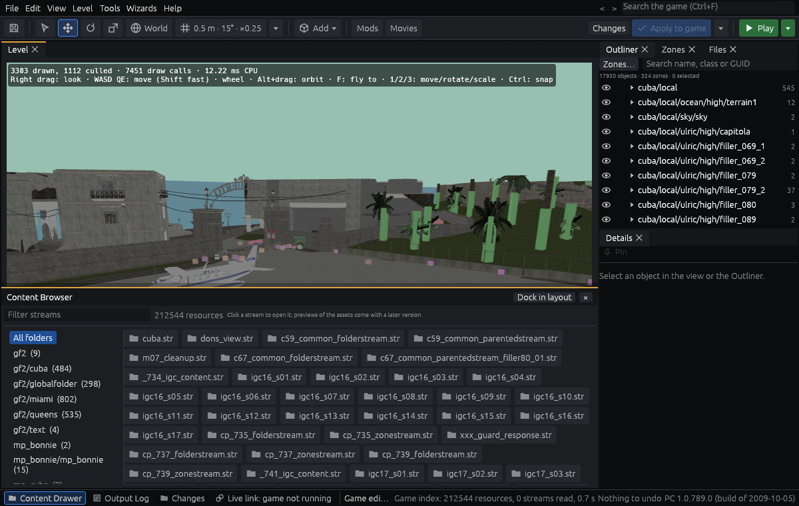<br>**Content Drawer** slides over the level view |
| 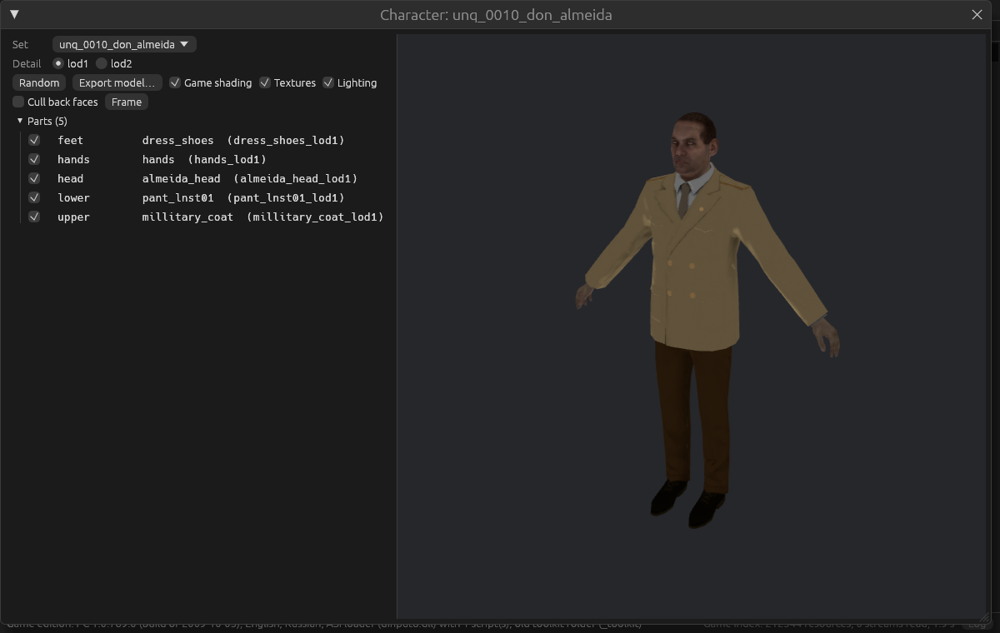<br>**Characters** assembled from their parts, the materials of a part in Details | 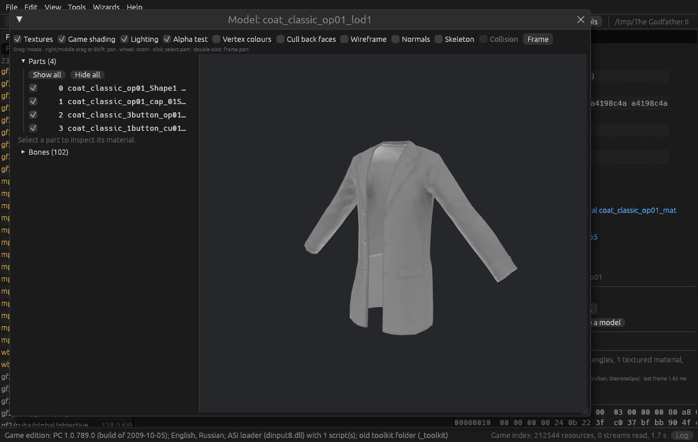<br>**Models** in a tab of their own: parts, bones, the selected part's material in Details |
| 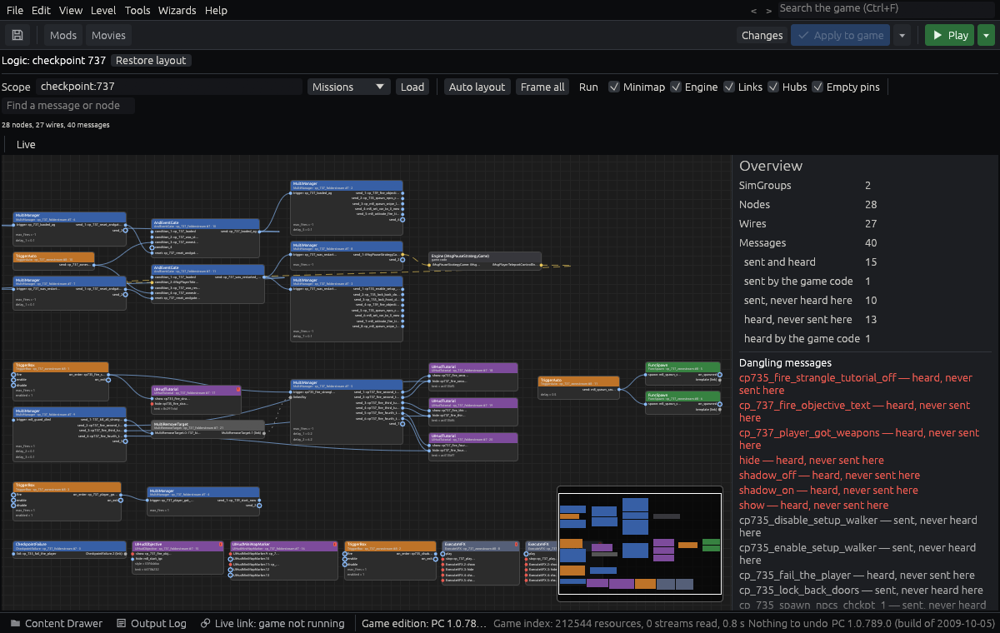<br>**Game logic**: who sends which message to whom, the selected node in Details | 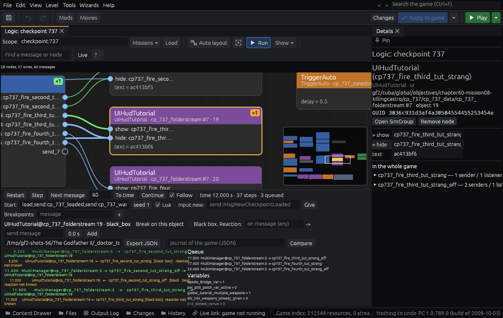<br>**Logic run** without the game: steps, queue, variables |
| 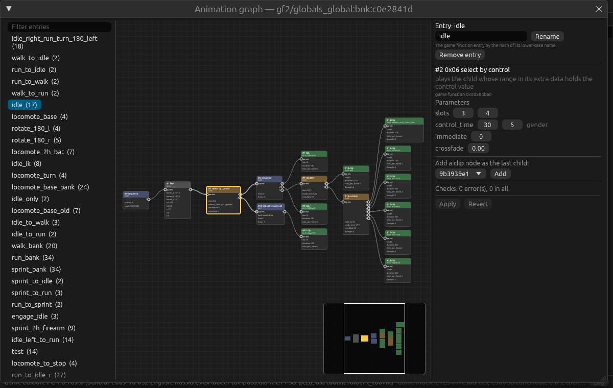<br>**Animation graphs**: entries, nodes, the parameters in Details | 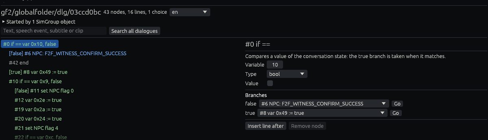<br>**Dialogues**: trees, conditions, lines |
| 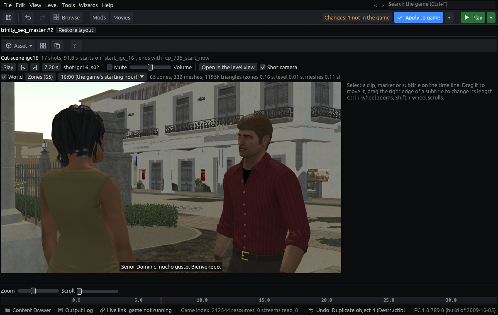<br>**Cut-scenes**: shots, subtitles, characters | 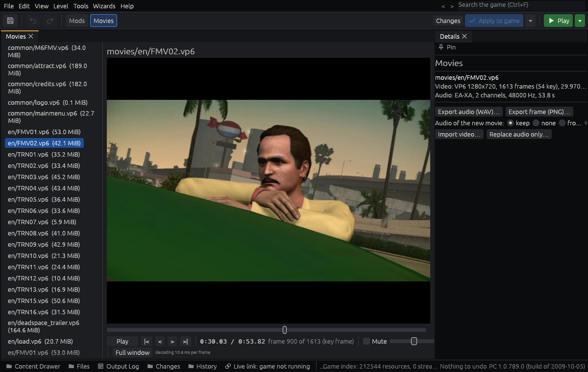<br>**Movies**: VP6 player with sound in a tab |
| 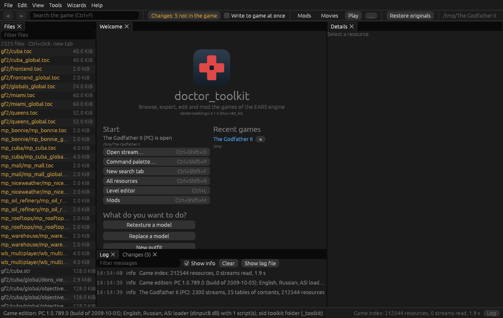<br>**Welcome page** with wizards for common tasks | 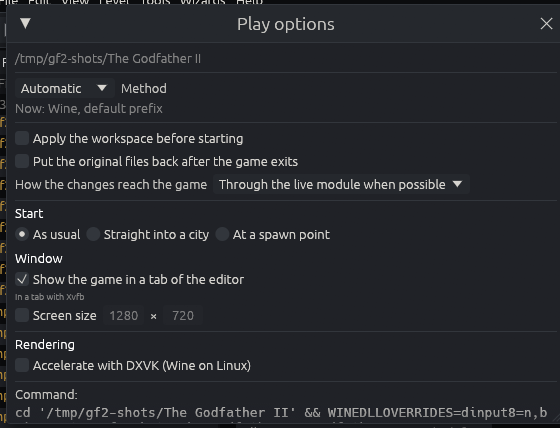<br>**Play**: straight into a city, in an editor tab, mods without writing to the game |

Pictures are made by `tools/screenshots.sh` and show data of the game for
documentation of this tool only.

## Quick start

1. Download the package for your system from the
   [latest release](https://github.com/Darkildo/doctor_toolkit/releases)
   (Linux x86_64, Windows x86_64, macOS) or
   [build from source](#building-from-source).
2. Unpack it and start the editor with the folder of your game:

   ```sh
   tar xzf doctor_toolkit-0.0.8-linux-x86_64.tar.gz && cd doctor_toolkit-0.0.8-linux-x86_64
   ./doctor-toolkit-gui "/path/to/The Godfather II"
   ```

3. Read the [user guide](docs/guide/README.md) (Russian) — installation,
   browsing, editing, mods, Play, dialogues, logic, cut-scenes and more.

This is a **beta**: back up your game folder before writing into it.

## What works

<details>
<summary>Everything the toolkit reads and writes, in detail</summary>

- Streams (`.str`, UStream): list, extract, rewrite, replace resources.
- Tables of contents (`.toc`, version 10): read, write, update stream sizes.
- RefPack compression and decompression.
- Textures (`tg4h` / `tg4d`): export to DDS (lossless) and PNG, preview in the GUI,
  import from DDS or PNG (encoded to the original format with a full mip chain).
- Localised text (`lh2`): export to JSON, edit, import back into the game;
  add new strings to every language (`text-add`, GUI "Add string") and point
  interface text (`$name` in `apx`, `apx-text-refs`) or SimGroup attributes at
  them. Entry ids are the SDBM hash of the lower-case entry name.
- Flash interfaces (`apx`): export `.apt` / `.const` data and embedded textures;
  replace embedded textures (PNG or DDS) and the `.apt` / `.const` data.
- Model formats: glTF 2.0, FBX (binary and ASCII 7.x; writes binary 7.4),
  OBJ + MTL and USD (`.usda`, `.usdc` crate, `.usdz`) are read and written by
  own Rust code through one scene model: meshes, materials, textures,
  skeletons, skin weights and animation clips (`models --format`,
  `model-import` of any format, `model-info`, `anim export --format`,
  `unpack --model-format` with `pack` importing edited models back, GUI
  "Export model…"; checked against Blender 5.3 both ways and on every game
  model and clip, `docs/model-formats.md`).
- Models (`mesh` + `meshvolatile` + `material`): export to binary glTF with
  materials and textures found anywhere in the game, and a skin (skeleton,
  inverse bind matrices, joint weights) for skinned models. Import of new
  models from glTF/GLB (`model-import`, GUI "Import model…"): static, rigid
  and skinned parts bound to a game skeleton by bone name, materials reused
  by name or cloned with the glTF textures, in place or as a new model set
  (`docs/model-import.md`). The mesh writer re-encodes all 17,622 game meshes
  byte for byte.
- A workspace: edits are kept on disk with undo, redo and a diff against the
  original, and written into the game on demand (one rewrite per stream,
  tables of contents updated, backups, atomic writes).
- Rigs (`rcb`): skeletons with bone names, parents and bind poses as JSON.
- Sound: `sbk` banks and the 24,913 streamed files of the `.viv` archives as
  `.snu` (playable with vgmstream) or decoded to WAV (EA-XAS v1). Import: an
  EA-XAS v1 encoder (WAV or anything ffmpeg reads, converted to the format of
  the replaced sound); bank sounds rebuild their `sbk`, streamed sounds go
  into a small overlay archive the game reads first, so the 4.7 GB archives
  are never rewritten (`sound-import`, GUI **Import…**). Replaced menu
  sounds were recorded playing in the game. Banks as a whole: emitters
  (sounds the game plays by `.emx` name), variations, sequencer commands,
  instruments and tones, written back byte for byte; volume, pitch and other
  parameters are edited, new variations and new emitters added
  (`sbk-info`, `sbk-edit`, `sound-add`, the bank tab of the GUI).
- Speech: speech banks (`smb`), the table of speech events (`get`), the audio
  configuration (`auc`) and mixer snapshots (`mix`) are read and written back
  byte for byte. A new voice line is made from a recording (`voice-add`, the
  **New voice line** wizard): the sound file as a new entry of the overlay
  archive, its entry in a speech bank, the line in the speaker's chatter set
  and the record of a new event; mods carry the sound with them. A new line
  with a new event was recorded playing in the game with its subtitle.
- Movies (`movies/*.vp6`, EA container with VP6 video and EA-XA audio): info,
  audio as WAV, frames as PNG (built-in decoder for key frames), replacement
  with a built-in VP6 encoder (Y4M input, or any video through an installed
  ffmpeg), new audio (WAV), new frame rate; the new movies play in the game.
  Replacements are workspace changes like any other (undo, revert, apply).
- Fonts (`ffn`): glyph atlas as PNG and glyph metrics as JSON.
- Face-to-face dialogues (`dlg`, `docs/formats/dialogues.md`): all 143
  dialogue trees read and written back byte for byte, with the chatter sets
  (`chv`), speech banks (`smb`) and the subtitles stored in the speech files
  of the `.viv` archives. A dialogue editor (lines, choices, conditions,
  re-linking, new lines, option texts in every language, subtitles and audio
  of the recorded lines, search across all dialogues, the SimGroup objects
  that start a dialogue); `dialogues`, `dialogue`, `dialogue-export`,
  `dialogue-import`, `subtitle`.
- In-engine cut-scenes (`trinity_seq_master`, `docs/formats/cutscenes.md`):
  all 260 shots read and written back byte for byte; the 25 sequences with
  their shots, actors (SimGroup objects, parts database sets), animation
  clips, camera curves, effects, engine commands and the subtitle table of
  the sound track. A cut-scene editor (time line with zoom and play head,
  3D preview through the shot camera with the actors posed by their clips,
  moving commands and subtitles, swapping clips, editing camera keys and
  commands, undo through the workspace); `cutscene list`, `show`, `export`,
  `import`, `move`, `clip`, `subtitle`, `gltf` (camera and actors as one glTF
  animation).
- Scripts (`lua`, Lua 5.0 with 4-byte float numbers): decompile to source
  that compiles back to the same instructions (27 of the 30 game scripts
  byte for byte), edit, compile with a Rust port of the Lua 5.0.3 compiler
  (byte-identical to `luac`), and record in the workspace (`docs/formats/lua.md`).
  Where mission logic lives and what a modder edits: `docs/formats/mission-logic.md`.
- Visual scripts (`docs/scripts.md`): Blueprint-like graphs (events, branches,
  delays, loops, gates, math, game variables, messages, timers, positions,
  audio and any game Lua function; 77 node kinds) kept as JSON, compiled to
  readable Lua 5.0 and to the game's bytecode, with errors on the nodes that
  cause them. A small Lua 5.0 VM runs the chunk against a mock of the game
  API (`script-run`) for tests and dry runs. `script-deploy` puts a script
  into a level as a `lua` resource and a `LuaAudioScript` object (one
  undoable workspace operation). Checked in the game: a new script runs when
  the level loads or on a game message, receives game messages, its messages
  reach SimGroup objects, it reads and writes game variables, its timers fire.
- Havok collision (`hkx`, Havok 5.5 packfiles): rigid bodies, shapes and MOPP
  trees read and written back byte for byte (11,233 of 11,258 files); export
  as OBJ/glTF; wireframe overlay in the model, resource and level views. New
  collision for a model from glTF or its mesh (`collision-build`,
  `model-import --collision`, `level add --collision`): a static triangle mesh
  with new MOPP code, a convex hull or a box (`docs/formats/havok.md`).
- Characters (`partsdb`, `docs/formats/characters.md`): every table of the
  68 parts databases decoded and written back byte for byte; parts reference
  their meshes by resource id. Assemble a character from a set (variants per
  slot, preset looks = material swaps, part colours, body and face morphs,
  culling tags), preview it in the GUI with game-like shading and export it
  as one glTF; add new parts (e.g. an imported outfit) to sets
  (`partsdb add-part`) or edit the whole database as JSON.
- Materials: all 77 shaders named (CRC-32 of names found in the
  executable); the viewer shades like the game's pixel shaders — tint masks
  of clothes, hair, skin, normal and detail maps, specular masks, alpha
  blending — with a material inspector of every parameter and sampler.
- Animations: the `bnk` resources are animation banks (6,115 clips, 826,643
  frames), not sound; every clip (schemes 1, 3 and 4) decodes, with its
  events (`audio: play`, `footstep`…), and exports as a glTF animation on the
  rig skeleton or on a character (`anim list`, `anim export`, GUI view).
  Banks are written back byte for byte (all 2,751); glTF, FBX and USD
  animations import over a clip or as a new clip with a named entry,
  retargeted by bone names with rest-pose correction and encoded with the
  game's codecs within an error budget, at the game's 29.97 frames per second (`anim import`,
  `anim events`, `anim encode-test`, Import clip… in the GUI).
- `mobface` (the crew editor): colour palettes, face sliders, menus as JSON.
- Game logic (`simgroup`, `metamodel`, `variabledictionary`, `partsdb`, `graph`):
  export to JSON; SimGroup objects with positions and attributes in the GUI.
  Editing: SimGroup attribute values, object position, rotation, scale and
  model; metamodel property and condition values; variable values; whole
  parts databases. Edited JSON goes back with `logic-import`, single values
  with `simgroup-set`.
- Mission logic as a graph (Kismet-like): SimGroup objects are nodes, message
  names and GUID links are wires. A schema of the pins of all 253 classes
  (messages heard and sent, links, parameters; the message bus was traced in
  `godfather2.exe`), graphs of a SimGroup, stream, mission, checkpoint or
  level, who sends and who hears any message across the game, dangling
  messages; connect, disconnect, add and remove nodes as workspace edits
  (`logic-graph`, `messages`, `logic-connect`, GUI tab **Logic**,
  `docs/logic-graph.md`). The logic runs without the game step by step:
  messages, variables, timers and Lua scripts, with the handlers of the main
  classes read from the exe, other objects as black boxes, breakpoints and a
  journal of who sent what to whom, compared with a journal of the game
  (`logic-run`, mode **Run** of the tab).
- Mods: a single ZIP file with a manifest, built from the workspace; a mod
  manager with load order, conflicts, compatibility checks, apply and restore;
  patches of the old closed toolkit (`.vpat`) install as mods.
- An integrity check that tells which game files differ from their originals
  and who changed them (the mod manager, the workspace, the old toolkit,
  another program).
- Backups of every changed game file and one-step restore.
- A game index with the names and references of every resource (cached,
  updated per stream): global search by name, hash, key, type and text of
  strings; "uses" and "used by" for any resource; a name dictionary for hashes.
- `unpack` / `pack`: resources as PNG, glTF, JSON and raw files with a
  manifest; edited files go back into the workspace.
- An MCP server for AI assistants (`doctor-toolkit mcp`): Claude Code,
  Claude Desktop or any MCP client searches the game, reads resources as
  JSON, follows the logic graph and lists level objects; `--allow-edits`
  adds edits through the workspace, `--allow-game` running the game on an X
  server of its own; a bridge with the open editor
  ([below](#ai-assistants-mcp)).
- A level editor: zones of every level in 3D (models with LODs, terrain,
  markers for objects without a mesh), fly camera, picking, move and rotate
  gizmos; duplicate, remove and add objects (with an existing or cloned
  model), all recorded in the workspace. 96 % of the objects with a model are
  drawn (29,579 of 30,746).
- A graphical browser for streams, tables of contents and all resources.
- External editors: "Open in external editor" (GUI) and `doctor-toolkit edit`
  export a texture (PNG/DDS), string table (CSV/JSON), game logic (JSON),
  Lua script or model (GLB) to a working file, open it in GIMP, Krita, Calc,
  a text editor or Blender, and import every save into the workspace (saves
  close together make one undoable step; `docs/external-editors.md`).
- A Blender add-on (Blender 4.2+, `tools/blender/`): open a game, search its
  models, import one with materials, textures and skeleton, export it back
  into the workspace (replace or new model set) with the import plan and
  checks in the panel; tested headless on static and skinned game models
  (`docs/blender.md`).
- First run and Play: installed copies of the game are found (Steam with
  Proton and shortcuts, Wine prefixes with their registry, Lutris, Heroic,
  Bottles; the Windows registry), their edition is told by the executable
  (version, build date, hash, copy protection, languages); an unmodified game
  gets a reference list of its original hashes, a game patched by the old
  toolkit is offered adoption. **Play** starts the game by Steam, Wine,
  Proton, Lutris, Heroic, Bottles or a command of your own, optionally with
  the workspace applied before and reverted after it exits; while the game
  runs the editor and the mod manager do not write into its files.
- The editor and the mod manager in English and Russian: the language of the
  system by default, switched at once in Preferences → Language (or the list
  at the top right of the mod manager), with correct Russian plurals; names
  of formats, paths, hashes, the command line and the log stay English
  (`DOCTOR_TOOLKIT_LANG=en|ru` overrides; `docs/shell.md` §5).

</details>

## Install (Linux)

Download `doctor_toolkit-<version>-linux-x86_64.tar.gz` from the releases,
unpack it anywhere and run the programs from that folder:

```sh
tar xzf doctor_toolkit-0.0.8-linux-x86_64.tar.gz && cd doctor_toolkit-0.0.8-linux-x86_64
./doctor-toolkit-gui "/path/to/The Godfather II"     # the editor
./open-mod-manager "/path/to/The Godfather II"       # Open Mod Manager, for players
./doctor-toolkit --help                              # the command line
./install-desktop.sh                                 # menu entries and icons (optional)
```

Requirements: x86_64 Linux with glibc 2.30 or newer (Ubuntu 20.04, Debian 11,
Fedora 31 and later). The binaries link only the C library at start-up, and
the editor also the ALSA library `libasound.so.2` for sound (package
`libasound2`/`libasound2t64`, Fedora and Arch `alsa-lib`; desktop systems
have it already). The windows need X11 or Wayland and Vulkan or OpenGL 3.3,
loaded at run time (without Vulkan the editor falls back to OpenGL). File
dialogs use the desktop portal or `zenity`. The command line needs no
graphics and no sound at all. Without a sound device the editor says why
and plays cut-scenes and movies by the frame timer.

## User guide

The full guide is in Russian: [`docs/guide/`](docs/guide/README.md). In short:

1. **Game directory** is the folder with `godfather2.exe` and `gf2/`
   (Steam/Proton: `~/.local/share/Steam/steamapps/common/The Godfather II`).
   The welcome screen and `doctor-toolkit detect` list the copies found on
   the computer with their edition. The first start builds an index of the
   game (a minute or two), cached in `~/.cache/doctor-toolkit/`, and offers
   to save the hashes of the original files (or to adopt the old toolkit's
   backups when it changed the game).
2. **Browse and export** in the editor, or with `textures`, `models`,
   `audio`, `text-export`, `logic-export` and `unpack` (examples below).
3. **Edit**: imports (textures from DDS/PNG, strings, raw data, `pack`) go to
   the workspace; nothing touches the game until **Apply to game**
   (`workspace apply`). Every changed game file is backed up first;
   **Restore originals** (`restore`) puts them back.
4. **Mods**: build a mod from the workspace (`mods build`, a single `.zip`),
   players install and apply it with Open Mod Manager (`open-mod-manager`).
   Patches of the old closed toolkit (`.vpat`) install as mods;
   `mods import-old` takes over a game patched by it.
5. **Play** (F5, `doctor-toolkit play`) starts the game, applying the
   workspace first and reverting it after the game exits if asked to.
   **Close the game** before changing its files: the editor and the mod
   manager lock writing while `godfather2.exe` runs (natively or under
   Wine/Proton), the command line warns.

Troubleshooting:

- Errors are printed with a hint; exit codes: 3 not found or not a game
  directory, 4 no permission or read-only, 5 disk full, 6 file in use,
  7 damaged or wrong file, 1 anything else, 2 bad arguments.
- *"Unable to find your profile"* under Wine/Proton: the game's profile folder
  is `Documents\EA Games\The Godfather™ II`, which Wine can only create in a
  UTF-8 locale. Start the game with `LC_ALL=en_US.UTF-8` (Steam launch
  options: `LC_ALL=en_US.UTF-8 %command%`).
- No window or a black window: try `DOCTOR_TOOLKIT_GUI_RENDERER=glow`.
- Bug reports: attach `~/.local/state/doctor-toolkit/log.txt` (versions,
  commands, errors, the game executable's size and hash) and the output of
  `doctor-toolkit integrity "$GAME"`.

## Building from source

Rust (rustup installs the version from `rust-toolchain.toml`), a C compiler,
`pkg-config` and the ALSA headers, since the editor plays sound by default:

| System | Packages |
|---|---|
| Debian, Ubuntu, Mint | `build-essential pkg-config libasound2-dev` |
| Fedora | `gcc pkgconf-pkg-config alsa-lib-devel` |
| Arch | `base-devel alsa-lib` |

```sh
cargo build --release                                           # all three programs, the editor with sound
cargo build --release -p doctor-toolkit-gui --no-default-features   # the editor without sound (no ALSA needed)
```

`audio` is the only default feature of `doctor-toolkit-gui`, so
`--no-default-features` needs nothing else. Without it sound banks do not
play (WAV export and import still work) and cut-scenes and movies follow the
frame timer. The command line and the mod manager never need ALSA. On
Windows the sound goes through WASAPI with no extra libraries.

## Command line

```sh
cargo build --release
T=./target/release/doctor-toolkit
GAME="/path/to/The Godfather II"

$T validate "$GAME" --decompress --roundtrip   # check every file
$T types "$GAME"                                # resource types in the game
$T list "$GAME/gf2/frontend.str" --type apx     # resources of a stream
$T extract "$GAME/gf2/frontend.str" -o out --index 17
$T replace "$GAME" gf2/frontend --index 17 --data new.apx
$T textures "$GAME" -o textures                 # every texture as DDS (add --png for PNG)
$T models "$GAME" gf2/globalfolder/characters/allcharacters -o models --name head
$T models "$GAME" gf2/globals_global -o models --name colt --format fbx   # glb, fbx, obj, usd, usda, usdc, usdz
$T models "$GAME" gf2/miami/local -o trees --name palm   # trees and palms (treemodel) of a stream
$T model-info models/colt_m1911.fbx               # what the importer sees in a model file
$T texture-import "$GAME" gf2/frontend buttons buttons.png
$T apx-export "$GAME" -o ui                      # Flash UI data and its textures
$T text-export "$GAME" -o text                   # string tables as JSON
$T text-import "$GAME" text/gf2/text/dd7d7050/00000_lh2_9e583c54.json
$T workspace apply "$GAME"                      # write the recorded edits into the game
$T skeletons "$GAME" -o rigs                     # rigs (rcb) as JSON
$T audio "$GAME" -o sound --banks-only           # sbk sounds as .snu (add --wav for WAV)
$T audio "$GAME" -o sound --wav --name ambush    # streamed audio from the .viv archives
$T fonts "$GAME" -o fonts                        # font atlases (PNG) and metrics (JSON)
$T dialogue "$GAME" 0c6576f0                     # a dialogue tree with speech and subtitles
$T dialogues "$GAME" --search Rosato             # search every dialogue
$T cutscene list "$GAME"                         # the 25 in-engine cut-scenes and their shots
$T cutscene show "$GAME" gf2/cuba/global/objectives/cp_010_030_mission_1/cp_009/cp_009_hotel_interior_folderstream
$T subtitle "$GAME" 'audiostreams\b4_xxx_0\d_mob4_xxx_0001cc7.exa.snu' --set en="New line"
$T video-info "$GAME"                            # every movie: size, frames, audio
$T video-export load --game "$GAME" -o out --audio --frame 0   # WAV and a PNG frame
$T video-import "$GAME" en/load --video new.y4m --audio new.wav  # replace a movie
$T sound-import "$GAME" 'gf2/frontend:sbk:6d4bafbd#11' click.wav  # a sound of a bank
$T sound-import "$GAME" 'audiostreams\e_screen\title_screen_01.exa.snu' theme.wav
$T sound-encode theme.wav -o theme.snu --like original.snu   # encode only
$T sbk-info "$GAME" gf2/frontend:sbk:6d4bafbd    # emitters, variations, tones of a bank
$T sbk-edit "$GAME" gf2/frontend:sbk:6d4bafbd --emitter '#4' --volume 0.5 --pitch 1.5
$T sound-add "$GAME" gf2/frontend:sbk:6d4bafbd beep.wav --new my_beep  # a new emitter my_beep.emx
$T voice-add "$GAME" gf2/globals_global:chv:18c7062e hello.wav --event DOCTOR_HELLO \
    --name doc1_xxx_0000001 --subtitle en="Hello."   # a new voice line (voice-add GAME --speakers lists the sets)
$T speech-events "$GAME" F2F_ENJOY_FLIGHT        # records of the speech event table
$T audio-config "$GAME"                          # mix categories, bank pools, ducks
$T mix "$GAME" global_f2f.mix --category MUSIC --volume 0.2   # a mixer snapshot
$T viv-list "$GAME" title_screen                 # files of the .viv archives
$T lua-export "$GAME" -o scripts                 # Lua 5.0 bytecode
$T lua-decompile "$GAME" -o scripts              # Lua source, checked by compiling it back
$T lua-import "$GAME" scripts/gf2/globals_global/aud_utils.lua   # compile, record in the workspace
$T lua-compile script.lua -o script.luac         # chunk with the game's float numbers
$T script-nodes                                  # node library of visual scripts
$T script-compile graph.json -o graph.lua        # graph -> Lua (errors name the nodes)
$T script-run graph.json send:iMsgX wait:5       # run against a mock of the game
$T script-deploy "$GAME" gf2/globals_global graph.json   # lua resource + LuaAudioScript
$T logic-export "$GAME" -o logic --type simgroup --stream mp_mall   # level objects as JSON
$T logic-import "$GAME" logic/gf2/frontend/00046_simgroup_00000000.json   # edited JSON back
$T save GF2-EN-autosave --chunk variables --game "$GAME"   # look into a save file (read only)
$T simgroup-set "$GAME" gf2/frontend 46 12 --set RenderingParams.1=0.5 --position 1,2,3
$T simgroup-add "$GAME" gf2/cuba/local 714 TriggerAuto   # a new object of a class, empty attributes
$T class-schema examples/native-class/classes.toml   # classes of a native mod (DOCTOR_TOOLKIT_CLASSES)
$T logic-graph "$GAME" mission:killingcastro      # nodes, wires, dangling messages
$T logic-graph "$GAME" checkpoint:737 --dot | dot -Tsvg > cp737.svg
$T messages "$GAME" cp_737_loaded                # who sends and who hears it
$T logic-connect "$GAME" --from "STREAM#7:10:send" --to "STREAM#7:15:show"
$T apx-import "$GAME" gf2/frontend popup --texture 1 --image panel.png   # embedded texture
$T apx-import "$GAME" gf2/frontend popup --apt popup.apt --const popup.const
$T model-import "$GAME" gf2/globalfolder/characters/allcharacters fringe_dress_lod2 dress.glb
$T model-import "$GAME" STREAM 319 box.glb --new doctor_box --retarget 42   # new model set
$T level list "$GAME" gf2/miami/local/bonita     # zones (streams with placed objects)
$T level info "$GAME" --levels                   # what the 3D level view can show
$T level objects "$GAME" gf2/miami/local/bonita/high/terrain06 --filter destructible
$T level duplicate "$GAME" gf2/miami/local/bonita/high/terrain06 63 5 --offset 2,0,0
$T level add "$GAME" gf2/miami/local/bonita/high/terrain06 63 5 --model 08334a16 --position -400,-18,510
$T collision-export "$GAME" -o collision --stream mp_mall/mp_mall   # hkx as OBJ + JSON
$T collision-build "$GAME" STREAM 319 --from wall.glb --kind mesh     # new collision for metamodel 319
$T text-add "$GAME" doctor_hello "Hello" --lang es=Hola             # new string in every language
$T apx-text-refs "$GAME" gf2/frontend 20 --set fe_press_start=doctor_hello
DB=gf2/globalfolder/characters/allcharacters
$T partsdb show "$GAME" $DB unq_tom_hagen        # sets, slots, variants, parts and meshes
$T partsdb character "$GAME" $DB wrk_male wrk_0014_cook --choose wrk_0014=b_teal_blue -o cook.glb
$T partsdb add-part "$GAME" $DB player --name my_hat --slot a_hat --mesh hat_dress_lod1 --set _all --only
$T anim list "$GAME" gf2/globals_global 2657     # animation clips of a bank
$T anim export "$GAME" gf2/globals_global 2657 --clip idle --partsdb player --set _all -o idle.glb
$T anim import "$GAME" gf2/globals_global:bnk:c0e2841d wave.glb --clip idle      # replace a clip
$T anim import "$GAME" gf2/globals_global:bnk:c0e2841d wave.glb --clip my_wave --add
$T anim encode-test "$GAME"                      # re-encode every clip: error and size
$T restore "$GAME"                              # undo all changes
```

### Workspace

`replace`, `texture-import`, `text-import`, `text-add`, `apx-text-refs --set`,
`logic-import`, `simgroup-set`, `apx-import`, `model-import`, `anim import`,
`anim events --set` and
`collision-build` record their change in the workspace, `<game>/_doctor_toolkit/workspace` by default; the game files stay
untouched until `workspace apply`. Add `--direct` to record and write into the
game at once, `--workspace-dir DIR` to use another workspace.

```sh
$T workspace status "$GAME"            # changes and whether the game has them
$T workspace diff "$GAME" [TEXT]       # sizes, changed bytes, strings, SimGroup values, apx blocks
$T workspace log "$GAME"               # operations; * marks those in effect
$T workspace undo "$GAME"              # undo / redo the last operation
$T workspace redo "$GAME"
$T workspace apply "$GAME"             # write into the game (--stream S for one stream)
$T workspace revert "$GAME" KEY...     # drop changes (or --all); apply then updates the game
$T workspace revert "$GAME" --game     # put the original files back, keep the changes
$T workspace init "$GAME" --dir DIR    # create a workspace somewhere else
```

Each change is identified by a resource key `stream:type:ids`, for example
`gf2/text/dd7d7050:lh2:9e583c54`; `revert` and `diff` accept a key or part of
one. A stream changed by another program is reported as a conflict and is only
overwritten with `apply --force`. `replace --no-toc` still writes straight into
the game without the workspace. The layout and the file formats are described
in `docs/workspace.md` (Russian).

### Mods

A mod is a ZIP file with `mod.json` (id, name, version, author, description,
home page, game, and every replaced resource with the SHA-256 of its new data
and of the original it expects) plus the new data under `payloads/`.
Installed mods live in `<game>/_doctor_toolkit/mods/`; later mods in the load
order win when two replace the same resource.

```sh
$T mods build "$GAME" -o my-mod.zip --name "My mod" --author me   # from the workspace
$T mods info my-mod.zip                       # show and verify a mod or a .vpat
$T mods install "$GAME" my-mod.zip patch.vpat # install (the game is not touched yet)
$T mods list "$GAME"                          # load order, enabled or not
$T mods move "$GAME" my-mod 1                 # change the load order
$T mods conflicts "$GAME"                     # resources changed by several mods
$T mods check "$GAME"                         # do the mods fit this game?
$T mods apply "$GAME"                         # write the enabled mods into the game
$T mods unapply "$GAME"                       # put the originals back, keep the mods
$T mods uninstall "$GAME" my-mod
$T mods import-old "$GAME"                    # take over the old toolkit's patches
$T integrity "$GAME"                          # who changed which game file
```

### Installed games and Play

```sh
$T detect                                     # copies of the game on this computer, editions
$T detect "$GAME" ~/.wine                     # check a folder or a Wine prefix
$T play "$GAME" --dry-run                     # how the game would be started
$T play "$GAME" --apply --revert-after        # apply the workspace, play, revert on exit
$T play "$GAME" --method wine --prefix ~/.local/share/wineprefixes/gf2
$T play "$GAME" --method steam                # steam -applaunch 24830
$T play "$GAME" --method command --command 'wine "{exe}" -windowed'
```

Methods: `steam`, `steam-shortcut`, `wine`, `proton`, `lutris`, `heroic`,
`bottles`, `direct` (Windows), `command`; `auto` picks what detection found
for this folder. With an ASI loader (`dinput8.dll`) in the game folder, Wine
gets `WINEDLLOVERRIDES=dinput8=n,b`. Editions known so far (`detect` prints
the values needed to add one, `crates/doctor-toolkit/src/edition.rs`):
1.0.789.0 of 2009-10-05 (digital, the build this toolkit is checked on) and
the retail DVD 1.0.764.0 of 2009-01-27 (SecuROM).

Mod files are untrusted: sizes, counts, entry names and every payload hash are
checked, nothing is extracted by name. A mod whose expected originals differ
from the game is refused unless `--ignore-compatibility`. The workspace and the
mod manager never write into the game at the same time; to test a workspace
together with other mods, install it as a mod (`mods install-workspace`).
Details, the `.vpat` format and what was found about it: `docs/mods.md` (Russian).

For players there is a separate program with only the mod manager,
**Open Mod Manager** (each release also has it alone, without the editor:
`open-mod-manager-<version>-<system>.zip` / `.tar.gz`; `open-mod-manager`, `open-mod-manager.exe` on Windows;
"Powered by Doctor": it is part of doctor_toolkit). It finds the installed
game by itself, installs mod files dropped on its window or opened from the
system, shows each mod as a card with its picture and its state in words
(ready, in conflict with another mod, not fitting this version of the game,
not written to the game yet), reorders them by dragging, keeps named sets
of mods, undoes the last change, and plays the mods without writing them
into the game ("Play with mods", through the live module) or writes them in
for good:

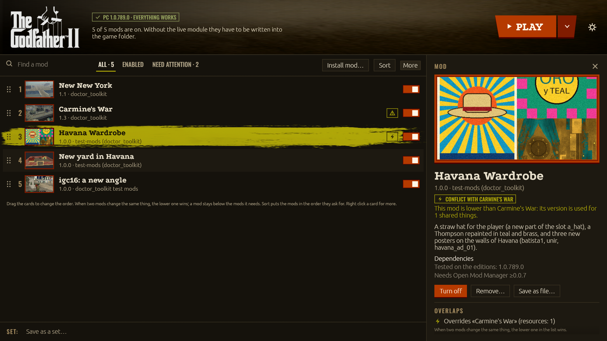

```sh
cargo run --release -p doctor-toolkit-mods --bin open-mod-manager -- "$GAME"
```

### Search, references, unpack and pack

```sh
$T search "$GAME" type:material rust             # names, globs (car_*), hashes, keys, text:…
$T refs "$GAME" gf2/frontend:tg4h:00000000.4802e0a7.f3d257db.9cf57f36   # uses / used by
$T hash tg4h                                     # a name under every hash function
$T lookup 38523fc3 --game "$GAME"                # names of a hash and where it occurs
$T unknown-hashes "$GAME"                        # hashes without a known name
$T unpack "$GAME" -o work --stream gf2/frontend  # PNG, glTF, JSON, raw + manifest.json
$T pack "$GAME" work                             # record the edited files in the workspace
$T index "$GAME" --unresolved 5                  # index statistics
```

The index is cached in `~/.cache/doctor-toolkit/` (`$DOCTOR_TOOLKIT_CACHE_DIR`
to change it), never in the game directory; streams changed since are read
again. `pack` skips unchanged files and refuses edits it cannot import (views
such as glTF and game-logic JSON, missing or unknown files) before recording
anything. See `docs/navigation.md` (Russian).

## Python

The module `doctor_toolkit` (crate `crates/doctor-toolkit-py`, `pyo3`, stable
ABI for CPython 3.9+) gives scripts and notebooks the same library: games,
streams and resources; textures (PNG, DDS, RGBA pixels), string tables, game
logic as dicts, models (vertices, triangles, binary glTF), rigs, fonts, sounds
(WAV, PCM); Lua scripts (`lua_decompile`, `lua_compile`, `lua_listing`); the
logic graph (`logic_graph`, `logic_messages`, `logic_missions`, `logic_run`); the
index with search and references; the workspace with undo,
diff, apply and unapply; mods. Library errors are Python exceptions with the
library's message; long operations release the GIL.

```sh
python3 -m venv .venv && . .venv/bin/activate && pip install maturin pytest
cd crates/doctor-toolkit-py && maturin develop --release && pytest
```

```python
import doctor_toolkit as dt

game = dt.Game("/path/to/The Godfather II")
for texture in game.stream("gf2/frontend").textures():
    open(f"{texture.name}.png", "wb").write(texture.to_png())

ws = game.workspace()                       # edits go to the workspace first
table = ws.string_table("gf2/text/dd7d7050:lh2:...")
ws.edit_strings(table.key, {table.hashes[0]: "New text"})
ws.apply()                                  # same checks as `workspace apply`

index = game.index()
index.search("type:simgroup mall")
```

Examples are in `examples/python/` (export a stream's textures, list SimGroup
objects of a class with positions, replace text in every string table); type
stubs in `crates/doctor-toolkit-py/python/doctor_toolkit/_native.pyi`; a guide
in `docs/python.md` (Russian). `cargo build --workspace` builds the module
without a Python interpreter (`.cargo/config.toml`).

## AI assistants (MCP)

`doctor-toolkit mcp GAME` is a [Model Context Protocol](https://modelcontextprotocol.io)
server on stdin/stdout (no network): an AI client such as Claude Code or
Claude Desktop reads the game through the toolkit. By default it only reads —
nothing in the game, the workspace or the project is written. Two flags turn
writing on:

| Flag | Tools |
|---|---|
| — | reading (below), the running game over the live link (`live_status`, `player`, `objects_near`), the open editor (`editor_selection`, `editor_open`, `editor_show_object`) |
| `--allow-edits` | edits recorded in the workspace, never in the game files: `set_attribute`, `move_object`, `duplicate_object`, `add_object`, `remove_object`, `edit_string`, `add_string`, `edit_script` (a visual script graph as JSON), `graph_edit` (navigation graphs), `undo`, `redo`; `project_build`, `mod_build` (format 2, into the workspace's `mods/`), `validate`, `scripts` |
| `--allow-game` | `apply`/`unapply` (the workspace into the game files and back), `play` (the game on an X server of its own — nothing shows on the desktop — optionally right in a level at a spawn point, DXVK, waits for the level), `stop`, `screenshot` (a PNG frame as image content), `teleport`, `send_message`, `lua` |

Every edit is one undoable operation of the workspace and its answer carries
the diff. The workspace is written by one program at a time: while the
editor has it open, a write is asked for in the editor (a window there,
through a local socket) or refused with a clear error.

```sh
# Claude Code
claude mcp add doctor-toolkit -- doctor-toolkit mcp "/path/to/The Godfather II"
# with a workspace or a mod project
claude mcp add doctor-toolkit -- doctor-toolkit mcp "$GAME" --project ~/mods/my-mod
# edits in the workspace and the game
claude mcp add doctor-toolkit -- doctor-toolkit mcp "$GAME" --allow-edits --allow-game
```

Claude Desktop, `claude_desktop_config.json`:

```json
{
  "mcpServers": {
    "doctor-toolkit": {
      "command": "/path/to/doctor-toolkit",
      "args": ["mcp", "/path/to/The Godfather II"]
    }
  }
}
```

Tools: `game_info`, `list_streams`, `search` (names, hashes, keys, types,
text of strings), `resource_info` (names, references, users),
`resource_json` (SimGroup, metamodel, strings, dialogues, cut-scene shots,
navigation graph, rigs, materials and more as JSON, Lua as decompiled source;
paged), `lookup_hash`, `strings`, `logic_graph` (object → messages →
listeners over N hops, a message across the game, a mission overview),
`level_objects` (placed objects with positions), `workspace_status`,
`workspace_diff`, `project_status`, `kb_search` and `kb_note` (the knowledge
base `docs/kb/`: what is known about the engine and the game, SimGroup
classes, addresses of the executable, experiments, open questions).
Resources: the format documents (`docs/formats/*.md`) and the knowledge base
(both built into the binary), the schema of logic pins, the engine's message
names, the messages and missions of the game. Game data in
results is fenced off as untrusted data, results are limited in size
(`--max-response-chars`). Details: `docs/mcp.md`, guide chapter 22 (Russian).

## External editors and Blender

```sh
# edit a texture in GIMP; every save is imported, Ctrl+C stops
doctor-toolkit edit "$GAME" gf2/frontend:tg4h:00000000.4802e0a7.f3d257db.9cf57f36 --with "gimp {file}"
# a string table as CSV with the program set in the editor's preferences
doctor-toolkit edit "$GAME" gf2/text/dd7d7050:0
```

The editor has the same as an "Open in external editor" bar above textures,
string tables, logic, scripts and models; the programs are set in
Preferences → External editors (`{file}` is the file; empty means the
desktop's program). The Blender add-on is packed by `tools/release.sh` as
`dist/doctor_toolkit_blender-<version>-linux-x64.zip` with the Python module
inside: Blender → Preferences → Get Extensions → Install from Disk. Its panel
(sidebar → Doctor Toolkit) imports game models and exports them into the
workspace; `tools/blender/run-tests.sh` runs the round trip in headless
Blender. Details: `docs/external-editors.md`, `docs/blender.md` (Russian).

## Graphical editor

```sh
cargo run --release -p doctor-toolkit-gui -- "$GAME"
cargo run --release -p doctor-toolkit-gui -- "$GAME" gf2/frontend   # open a stream directly
```

- The window looks and works like the Unreal Engine 5 editor: a menu bar
  (File, Edit, View, Level, Tools, Wizards, Help), a main toolbar (save; for
  a level the gizmo modes, world or local axes, snapping and **Add**; the
  changes not yet in the game, **Apply to game** and a green **Play**),
  tabs with dockable panels and a status bar with the **Content Drawer**
  (Ctrl+Space) and **Output Log** buttons, the live link, the last edit to
  undo and the game edition. Streams, resources, searches and levels open as
  tabs; **Files**, **Details**, **Changes**, **Log**, **Outliner**,
  **Zones** and the **Content Browser** are panels that can be hidden
  (Ctrl+1…6), dragged into other groups, split, or made a drawer that slides
  up over the window. Two layouts come built in, **Level Editor** (the view
  large, Outliner over Details on the right, drawers below) and
  **Resources**; your own layouts are saved, renamed and deleted under
  View → Layouts, and each kind of screen (level, resources) remembers its
  layout. Double-click a tab (Ctrl+M) to show it alone. Tabs, layouts, the
  last game and selection come back at the next start. The **command palette**
  (Ctrl+Shift+P) runs any menu command and opens streams and resources by
  name, key, hash or text; **Help → Keyboard shortcuts** lists every key.
  Preferences (Ctrl+,): theme, interface scale, language, renderer, editors
  and folders, kept in `~/.config/doctor-toolkit/settings.toml`. Warnings and
  errors pop up, stay in the Log panel and go to the log file
  (Help → Show log file). Details in `docs/shell.md` (Russian).
- **Files** lists streams and tables of contents (Ctrl+click opens a new
  tab); **All resources** lists every resource of the game by type.
- Selecting a resource shows its header and data in **Details**; double-click
  (or **Open in tab**) keeps it open in a tab of its own. Textures, Flash
  interfaces and models get a preview; rigs show their bone tree, fonts their
  atlas, sound banks a summary. Scripts (`lua`) open in a Lua editor:
  decompiled source with syntax colours and line numbers, checked by the
  compiler while typing (the line with an error is marked), **Save to
  workspace**, the bytecode listing, export and load of `.lua` files.
- **Models** render on the GPU (wgpu): drag to rotate, right-drag or
  Shift-drag to pan, wheel to zoom, `F` to frame, double-click to frame a
  part. Toggles for textures, lighting, alpha test, vertex colours, back-face
  culling (to look into interiors), wireframe and normals; the part list
  shows and hides parts and names their materials and textures, which also
  appear under the cursor. **Skeleton** draws the matching rig with bone
  names; hovering a bone colours the vertices by its skinning weight.
  **Window** opens the viewer in a large window. Without a GPU adapter the
  editor runs on OpenGL with a software preview.
- **Textures**: wheel to zoom around the cursor, drag to pan, **Fit** and
  **1:1**, R/G/B/A channels and **Alpha only** over a checkerboard, mip level,
  cube face or volume slice, and the pixel value under the cursor.
- **Sound banks** (`sbk`): **WAV…** saves a sound, **Import…** replaces it
  with an audio file (recorded in the workspace); **Play** plays it on the
  default output device (not in a build with `--no-default-features`).
- SimGroup resources list their objects (filter by class, name or GUID);
  selecting one shows its transform, model and attributes. GUID attributes
  that point to another object of the group are links. Attribute values are
  edit fields (Enter applies, Escape restores, empty = default; wrong values
  are refused at the field); **Transform** edits position, rotation and
  scale; **Show unset attributes** lists the defaults to set them. Edited
  objects and attributes are marked. Other game-logic types open as a
  collapsible tree; **Export JSON…** / **Import JSON…** edit every
  supported type through a file.
- Flash interfaces (`apx`): **Import…** under an embedded texture,
  **Import .apt…** / **Import .const…** and their exports.
- **Import…** under a texture replaces it with a DDS or PNG file.
- String tables (`lh2`) open in an editor; **Save** records the edits.
- Edits go to the workspace. Previews show the edited version: textures next
  to the original, changed strings highlighted with the original as a tooltip,
  changed resources marked with `*` in the stream.
- The change counter in the toolbar shows the Changes panel with their state
  (pending, applied, conflict), byte and string diffs and the history;
  **Apply to game** writes them, **Revert game** puts the originals back.
  Ctrl+Z / Ctrl+Shift+Z undo and redo.
- **Write to game at once** (under **Apply to game ▾**) applies every
  change immediately (direct mode).
- **Tools → Level editor** (Ctrl+L) opens the level editor in a tab, in the
  Level Editor layout; the tab is the view, the panels around it do the
  rest. Check zones in the **Zones** panel (a district's
  `high` directory is a good start) and **Load**; the scene fills in while
  meshes convert in the background. Right-drag looks around, W A S D / Q E
  move (Shift faster), the wheel moves forward, Alt-drag orbits the selection,
  `F` or a double-click flies to it. Click selects an object (Ctrl+click
  adds more). The **Outliner** lists the objects by zone and class, with
  search by name, class or GUID, Ctrl/Shift multiple selection, an eye that
  hides and a lock that keeps clicks in the view from selecting, "new" and
  "edited" marks and a context menu (fly to, duplicate, delete, show logic,
  open the SimGroup, copy the GUID). **Details** shows what was selected
  last, an object or a resource: Transform with X/Y/Z fields dragged by the
  mouse, Model with a picture and a model chooser, Logic, Collision and
  Advanced (every attribute); **Pin** keeps it on one object and
  View → Another Details panel opens a second one. The gizmo moves (`1`), rotates (`2`) or scales
  (`3`) along the world's or the object's axes (toolbar), and snaps to
  steps (0.5 m / 15° / ×0.25 by default) always or with Ctrl. **Duplicate**, **Remove** and
  **Add object** (a copy of the selected object with another metamodel, or a
  clone of one in this zone) record their edit in the workspace; undo works
  as everywhere. Trees and palms (`treemodel`) are drawn as in the game, leaves
  turned to the camera; buildings, roads and ground, shaded as in the game,
  get the game's materials: tints, a second texture layer blended by a mask
  (dirt and patches), baked occlusion, normal maps and highlights, decals over
  the ground and the sky reflected in windows and metal, the sun's shadows,
  street lamps, lit windows and signs at night and the game's colour grading
  by the time of day (Shadows and Lamps switches in the Lit menu). Filters hide markers, trees, AI points and object
  classes; **Markers** over the view hides spawn points, triggers and other
  editor markers (hidden by default when shading as in the game).
  New objects have the
  collision of their model; a clone can get its own ("Own collision"), and
  "Collision" draws the collision of the selected object. Details in
  `docs/levels.md` (Russian).
- **Tools → Logic graph** (Ctrl+G) shows the logic of a mission, checkpoint,
  stream or SimGroup as nodes and wires (also from **Logic graph** in a
  SimGroup and in the level editor). Drag from pin to pin to connect, Delete
  removes, double-click shows the object in the level; the side panel edits
  messages, delays and parameters and lists who sends and hears each
  message in the whole game. Node positions are kept in the workspace
  folder, never in game data (`docs/logic-graph.md`, Russian).
- **Mods** in the toolbar opens the mod manager of the game, with a section
  that builds a mod from the workspace or installs it as a mod.
- **Movies** in the top bar lists the game's movies with their details, a
  frame preview, WAV and PNG export, and **Import video…** / **Replace audio
  only…** (encoded in the background, recorded in the workspace).
- **Search** (Ctrl+F) searches the whole game in a search tab
  (Ctrl+Shift+F opens another); the panel of a resource lists
  its names, what it uses and what uses it, as links. **<** / **>**
  (Alt+Left / Alt+Right) go back and forward.
- Ctrl+click and Shift+click select several resources; **Export selected…**,
  **Export N shown…** (a whole type in **All resources**) and the search
  results export as `unpack` does, in the background.
- Every write backs up the original file first. **Restore originals**
  (after a confirmation) puts back every original file; workspace changes
  stay pending.
- `tools/install-desktop.sh` adds the editor and the mod manager to the
  application menu of the user, with their icons (`--uninstall` removes them).
- New resource views plug into a registry (`views.rs`); how to add one is in
  `docs/viewers.md` §0 (Russian).

Close the game before changing its files.

The renderer and the screenshot and benchmark switches used for checks
without a user are described in `docs/viewers.md` (Russian).

## Development

```sh
cargo test                                        # unit tests
EARS_GF2_DIR="$GAME" cargo test --release --test corpus   # tests on the game files
(cd crates/doctor-toolkit-py && maturin develop --release && EARS_GF2_DIR="$GAME" pytest)   # Python
tools/game-bench.sh shadow "$GAME" /tmp/shadow gf2/frontend.str   # shadow copy of the game
KEYS="52:Return" tools/game-bench.sh run /tmp/shadow out/run      # run it under Wine in a hidden nested X server
```

`tools/game-bench.sh` never touches the real display or the game directory; see
`docs/analysis/game-bench.md` (Russian).

Every parser of untrusted input has a `cargo-fuzz` target in `fuzz/` (a
separate crate, nightly toolchain):

```sh
cargo +nightly fuzz list
cargo +nightly fuzz run -O ustream -- -max_total_time=300 -rss_limit_mb=2048 -malloc_limit_mb=512
```

Seed corpora come from small resources of the game (keep them outside the
repository); `fuzz/seeds/` holds a few synthetic ones used by CI.

Release archive: `tools/release.sh` builds `dist/doctor_toolkit-<version>-linux-x86_64.tar.gz`
with the `dist` profile (thin LTO, stripped) and checks the dynamic
dependencies (the C library, and `libasound.so.2` for the editor); with
`cargo-zigbuild` and `zig` installed it links against glibc 2.31;
`tools/package.sh` builds the Windows and macOS packages. CI
(`.github/workflows/`): every change to the code runs fmt, clippy and the
tests on Linux and the Python bindings (`ci.yml`); the fuzz targets run
weekly (`fuzz.yml`); a `v*` tag builds the packages for Linux, Windows and
macOS and the live-link module and puts them on a draft release
(`release.yml`).

Documentation of the file formats is in `docs/formats/` (Russian).

## Community

Join the Discord server of the community: questions, help with mods, bug
reports, news and work in progress.

<p align="center">
  <a href="https://discord.gg/MatbKKdFR"></a>
</p>

Invite: https://discord.gg/MatbKKdFR

## Credits

- **[Greavesy1899](https://github.com/Greavesy1899)**, author of
  [VisceralToolkit](https://github.com/Greavesy1899/VisceralToolkit), the tool
  suite for the games of EA Redwood Shores / Visceral Games. This work made a
  large contribution to the project: comparing notes with that editor helped
  us find and fix real bugs (among them a mesh record field our writer copied
  from its template) and name many fields of the formats; every such fact was
  then checked against the PC game. Thanks as well for years of support of the
  whole The Godfather modding community.

## License

GPL-3.0-only. This project contains no game data and is not affiliated with
or endorsed by Electronic Arts. You need your own copy of the game.
