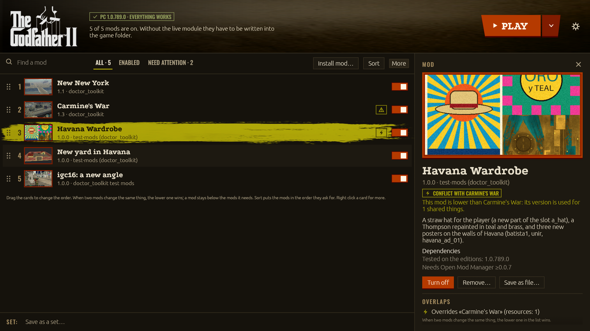
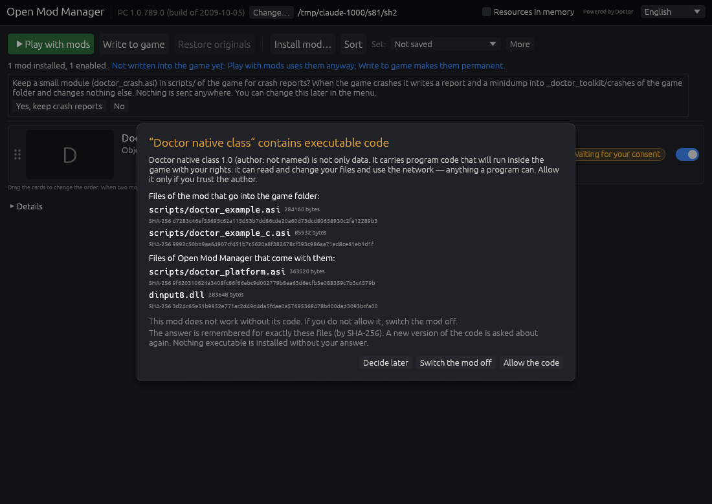

# 7. Моды для игроков

## 7.1 Open Mod Manager

Open Mod Manager — отдельная программа для игроков из поставки
doctor_toolkit (файл `open-mod-manager`, на Windows `open-mod-manager.exe`;
подпись «Powered by Doctor» в правом верхнем углу окна). Редактор для неё не
нужен.



**Первый запуск.** Программа сама ищет установленную игру (Steam, Proton,
Wine, Lutris, Heroic, Bottles, на Windows — реестр и обычные папки). Нашлась
одна копия — она сразу открывается; несколько — выберите нужную; ни одной —
нажмите **Указать папку игры…** и выберите папку, где лежит
`godfather2.exe`. Выбранная игра запоминается (`game` в `mods.toml` рядом с настройками
редактора); **Сменить…** вверху окна открывает выбор
снова. Папку можно передать и в командной строке:

```sh
open-mod-manager "/путь/к/The Godfather II"
```

**Установка.** Перетащите файл мода (`.zip`) или патч старого тулкита
(`.vpat`) в окно, нажмите **Установить мод…** или откройте файл мода из
системы: двойной щелчок или «Открыть с помощью → Open Mod Manager» (на
Linux после `install-desktop.sh` программа предлагается для `.zip` и `.vpat`;
на Windows выберите `open-mod-manager.exe` в «Открыть с помощью»). Файл,
открытый из системы, ставится после вопроса. При установке игра не
меняется.

**Список модов** — карточки: картинка, имя, версия, автор, начало описания,
переключатель вкл/выкл и состояние словами (раздел 7.2). Порядок меняется
перетаскиванием карточки за любое место; если два мода меняют одно и то же,
побеждает нижний. Правый щелчок по карточке — **Выше**, **Ниже**, **В
начало**, **В конец**, **Включить/Выключить**, **Удалить…**. С клавиатуры:
↑/↓ — выбрать мод, Alt+↑/↓ — сдвинуть, Пробел — включить/выключить,
Delete — удалить, Ctrl+Z — отменить. Щелчок по карточке показывает мод
целиком: большая картинка, описание, что означает его состояние и раздел
**Зависимости** — какие моды ему нужны, какие он рекомендует, с какими не
работает, после или до каких просит его загружать и каким модам нужен он
сам; зелёным — что в порядке, красным — что мешает. Там же кнопка
**Включить нужные моды**.

**Зависимости и порядок.** Мод может требовать другой мод (например, патч
поверх большого мода). Такой мод сам встаёт ниже того, что ему нужно, при
установке и включении; кнопка **Упорядочить** расставляет весь список так,
как просят моды, не трогая ваш порядок там, где правил нет. Перетащить мод
выше того, что ему нужно, нельзя — строка внизу объяснит почему; против
пожелания автора («загружать после…») — можно, с предупреждением. При
включении мода с выключенными зависимостями окно предложит **Включить все**
или **Только этот**; при выключении или удалении мода, который нужен
включённым модам, — спросит и назовёт их.

**Главные действия:**

- **Играть с модами** — игра запускается с включёнными модами, а её файлы
  не меняются: моды собираются в копии вне игры, и модуль связи подаёт их
  игре (как **Play** в редакторе, раздел [11](11-play.md)). Нужны загрузчик
  ASI в папке игры (`dinput8.dll`, Ultimate ASI Loader) и модуль
  `doctor_live.asi` рядом с программой (он в выпуске). Если чего-то нет,
  окно скажет, чего, и предложит **Записать в игру и играть**.
  Флажок **Ресурсы в памяти** вверху окна (выключен; экспериментальный)
  делает запуск с большими модами быстрее: вместо копии каждого
  изменённого файла игры готовятся только изменённые ресурсы, и модуль
  подставляет их, пока игра загружает файл. Если с ним игра ведёт себя
  неправильно, снимите его.
- **Записать в игру** — записать включённые моды в файлы игры насовсем
  (после вопроса). Перед записью оригиналы копируются в
  `_doctor_toolkit/backups/`; окно показывает ход записи и итог. Выключили
  или удалили мод — запишите ещё раз.
- **Вернуть оригиналы** — вернуть все файлы, изменённые менеджером модов
  (после вопроса); моды остаются в списке.

**Отмена.** Последнее изменение — включение, выключение, порядок, удаление
мода, переключение набора — отменяется кнопкой **Отменить: …** под
кнопками или Ctrl+Z. Удалённый мод возвращается на своё место.

**Наборы модов.** Список **Набор** запоминает, какие моды включены и в
каком порядке: **Сохранить как набор…**, затем переключайтесь между
наборами одним щелчком. Наборы лежат в `_doctor_toolkit/mods/sets.json`.

**Ещё** — проверка файлов игры (раздел [8](08-integrity.md); итог —
простыми словами), перенос из старого тулкита (раздел 7.3) и два флажка
для опытных: перезаписывать файлы, изменённые другими программами, и
записывать, даже если оригиналы игры отличаются от ожидаемых модами.
Технические подробности — потоки, ресурсы мода, конфликты по ключам
ресурсов, список проверенных файлов — в свёрнутом разделе **Подробности**.

**Что в файле.** Перед установкой менеджер читает и проверяет каждый файл
и показывает, что в нём: имя, версию и автора мода, сколько ресурсов и в
каких потоках он меняет, какие моды ему нужны и с какими он несовместим,
есть ли в нём исполняемый код. Файл, который не читается, назван с
причиной и не ставится.

**Сохранить мод файлом.** Правый щелчок по карточке мода → **Сохранить
файлом…** записывает установленный мод файлом `.zip` — передать его или
оставить копию (то же, что `mods export`).

## 7.2 Состояния мода

| Состояние | Что значит | Что делать |
|---|---|---|
| Готов (зелёный) | включён и записан в игру | — |
| Ещё не записан в игру (синий) | включён; «Играть с модами» его уже использует | **Записать в игру**, если нужно насовсем |
| Конфликт с … (жёлтый, значок ⚠) | другой включённый мод меняет те же ресурсы; берётся вариант нижнего | поменять порядок или выключить один |
| Не работает вместе с … (красный) | моды добавляют одно и то же по-разному, записать их вместе нельзя | выключить один |
| Несовместим с … (красный) | автор мода пишет, что он не работает с тем модом (причина — в подсказке) | выключить один |
| Нужен мод … ≥1.1 (красный) | нужного мода нет или он выключен | установить и включить его (**Включить нужные моды**) |
| Нужна версия … ≥1.1 (красный) | нужный мод установлен, но не той версии | обновить его; записать всё равно — флажок совместимости в **Ещё** |
| … должен быть выше (красный) | нужный мод ниже в списке | **Упорядочить** или перетащить |
| Обновите Open Mod Manager (красный) | мод сделан для более новой программы | обновить Open Mod Manager |
| Не подходит к этой версии игры (красный) | ресурса или потока нет в игре, или оригинал отличается: мод для другого издания либо файлы изменила другая программа; или автор проверил мод только на других изданиях игры (подсказка их называет) | выключить мод или проверить файлы (раздел [8](08-integrity.md)); записать всё равно — флажок в **Ещё** (`--ignore-compatibility`) |
| Ждёт вашего согласия (жёлтый, значок ⚠) | в моде есть исполняемый код (§7.5), а вы ещё не ответили, ставить ли его. До ответа ничего исполняемого в игру не кладётся; у мода, которому код обязателен, не пишется ничего | выбрать мод и нажать **Ответить про код…** или выключить мод |
| Код мода поставить нельзя (красный) | код моду обязателен, но поставить его нельзя: игра другого издания, нет ASI-загрузчика, имя файла занято чужим (причина — в подсказке) | выключить мод или устранить причину |
| Выключен (серый) | игра его не получает | — |
| Повреждён | файлы установленного мода испорчены | удалить и установить заново |

## 7.3 Патчи старого тулкита

Если игра раньше менялась закрытым «старым тулкитом» (папка `_toolkit` в
каталоге игры), выберите **Ещё → Перенести из старого тулкита**
(English: **Import from old toolkit**): его резервные копии станут
оригиналами, установленные патчи — модами. Файлы игры при этом не
меняются. Первая запись после перехода — **Записать в игру** с флажком
«Перезаписывать файлы, изменённые другими программами» (меню **Ещё**):
потоки пересоберутся из настоящих оригиналов с теми же данными и
правильными таблицами содержимого.

Отдельный патч `.vpat` ставится как обычный мод: перетащите его в окно или
нажмите **Установить мод…**.

## 7.4 То же из командной строки

```sh
doctor-toolkit mods install "$GAME" mod.zip patch.vpat
doctor-toolkit mods list "$GAME"
doctor-toolkit mods move "$GAME" my-mod 1
doctor-toolkit mods sort "$GAME"                 # по зависимостям и правилам модов
doctor-toolkit mods enable "$GAME" patch --with-deps
doctor-toolkit mods conflicts "$GAME"
doctor-toolkit mods apply "$GAME"
doctor-toolkit mods unapply "$GAME"
doctor-toolkit mods import-old "$GAME"
```

## 7.5 Моды с исполняемым кодом

Обычный мод — это данные: текстуры, модели, тексты, логика. Они не могут
навредить компьютеру. Некоторые моды несут ещё и **программный код** —
файлы `.asi` (DLL), которые работают внутри игры: новые классы объектов,
новые функции скриптов. Код может всё, что может программа: читать и
менять ваши файлы, ходить в сеть. Поэтому с такими модами менеджер
осторожен:



- у мода на карточке метка **«Исполняемый код»**;
- после установки менеджер спрашивает и показывает, какие именно файлы
  лягут в папку игры (`scripts/…​.asi`), их размеры и контрольные суммы
  SHA-256 — их можно сверить с тем, что опубликовал автор. Вместе с кодом
  мода менеджер кладёт свои файлы: `scripts/doctor_platform.asi` и, если в
  папке игры нет ASI-загрузчика, `dinput8.dll`;
- **пока вы не ответили, ничего исполняемого в папку игры не кладётся**;
- ответы: **Разрешить код**, **Только данные** (мод ставится без кода —
  если автор это допускает), **Выключить мод**, **Решу позже**;
- ответ запоминается для этих самых файлов. Если мод обновился и код в нём
  другой, менеджер спросит снова, а прежний код из игры уберёт;
- код ставится при **Записать в игру** (и при **Играть с модами**), а
  убирается сразу, как только мод выключен или удалён, и при **Вернуть
  оригиналы**. Передумать можно в карточке мода: **Спросить снова**.

Код работает только в издании игры PC 1.0.789.0. В другом издании мод,
которому код обязателен, не записывается; остальные ставятся без кода.

Под Wine и Proton модули `.asi` загружаются, только если игра запущена с
`WINEDLLOVERRIDES=dinput8=n,b` (в Steam — строка запуска
`WINEDLLOVERRIDES="dinput8=n,b" %command%`); «Играть с модами» ставит эту
переменную сама.

Разрешайте код только тем авторам, которым доверяете: менеджер проверяет,
что файл цел и тот же, что в моде, но не может проверить, что он делает.
