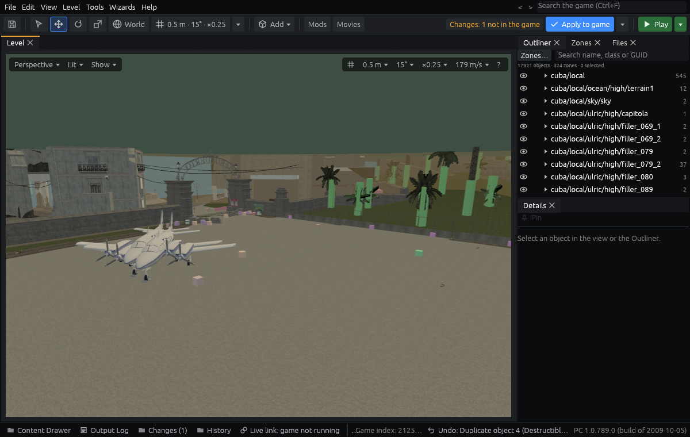
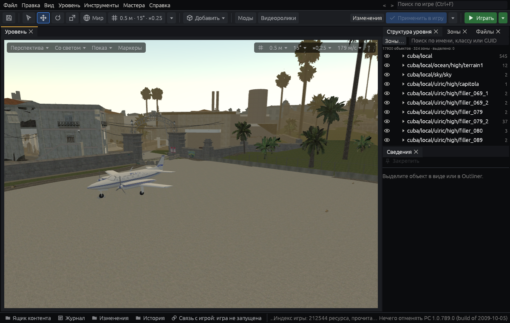
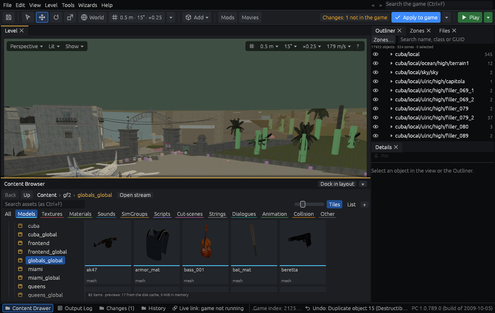
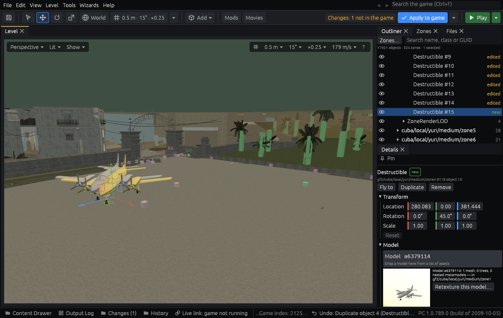
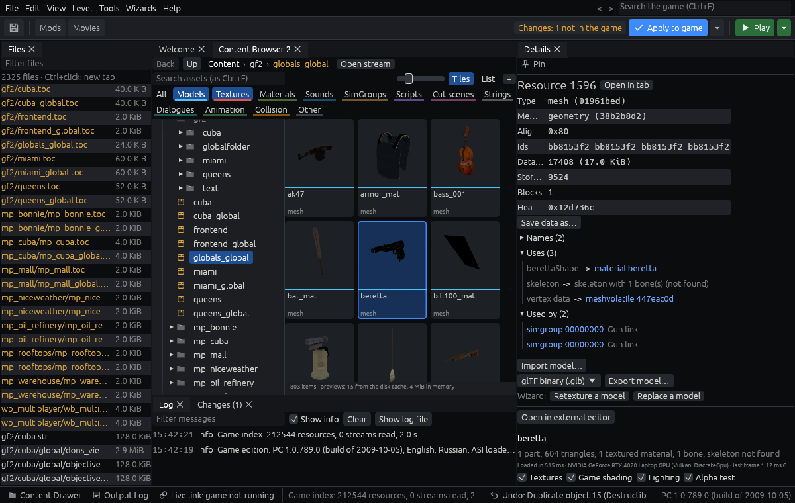
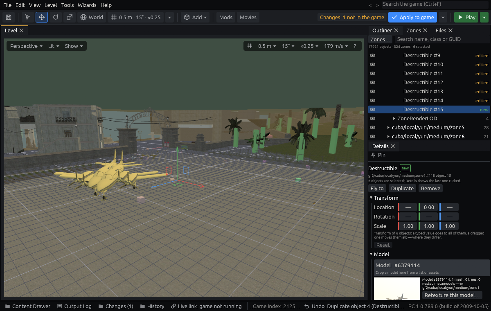
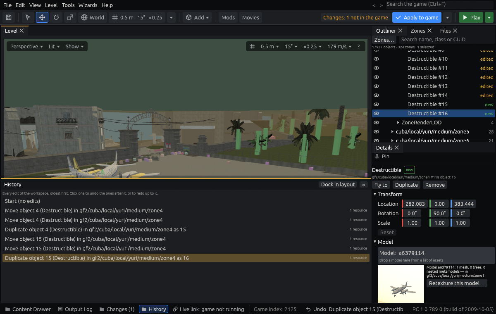
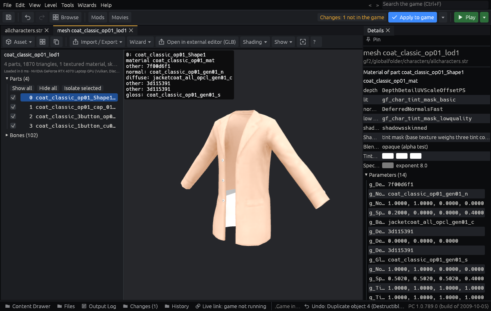

# 10. Окно редактора: вкладки, меню, настройки

## 10.1 Из чего состоит окно

Окно устроено как редактор Unreal Engine 5.

- **Меню** (File, Edit, View, Level, Tools, Wizards, Help) — все действия
  редактора; у частых справа написаны клавиши. В правом конце строки меню —
  **<** и **>** (назад и вперёд по переходам) и поле поиска по всей игре.
- **Панель инструментов** под меню (§10.8): сохранить; для уровня — режимы
  гизмо, оси, привязка и «Add»; **Mods**, **Movies**; справа — сколько
  изменений ещё не в игре, **Apply to game** и зелёная кнопка **Play** с
  меню «▾» (способ запуска, раздел [11](11-play.md)).
- **Вкладки и панели** в середине — их расположение называется
  раскладкой (§10.9).
- **Строка состояния** внизу: кнопки **Content Drawer** и **Output Log**
  (выдвижные панели, §10.10), состояние связи с игрой, фоновые задачи с
  ходом и кнопкой **Cancel** (если задач несколько — кнопка «+N»
  показывает все), последнее сообщение; справа — «Undo: …» с последней
  правкой и издание игры.

Без открытой игры в середине — **Welcome**: «Open game…», найденные на
компьютере копии игры с изданием, недавние игры и ссылки на это руководство
и клавиши.

## 10.2 Вкладки и панели

Открытые потоки, ресурсы, поиски и уровни — **вкладки**, их может быть
сколько угодно. Вокруг них — **панели**: **Files** (потоки и TOC игры),
**Details** (выбранный ресурс), **Changes** (изменения рабочего
пространства) и **Log** (сообщения).

| Что сделать | Как |
|---|---|
| Открыть поток | щелчок в Files — в текущей вкладке потока; Ctrl+щелчок или средняя кнопка — в новой |
| Открыть ресурс отдельной вкладкой | двойной щелчок в списке, средняя кнопка, «Open in tab» в Details |
| Вернуться из вкладки ресурса к его потоку | «Show in stream» |
| Новый поиск во вкладке | Ctrl+Shift+F или Tools → New search tab; Enter в поле поиска ищет в текущей вкладке поиска |
| Редактор уровня | Tools → Level editor (Ctrl+L); ещё одна вкладка уровня — Tools → New level tab (Ctrl+Shift+L) |
| Переставить | перетащить вкладку в другую группу или к краю группы — получится новое разделение |
| Показать вкладку одну | двойной щелчок по ней или Ctrl+M; повтор или «Restore layout» — обратно |
| Закрыть | крестик, средняя кнопка, Ctrl+W; правый щелчок — «Close other tabs» |
| Спрятать и вернуть панель | крестик на панели прячет её, View → Files/Details/Changes/Log/Outliner/Zones (Ctrl+1…6) возвращает на место |
| Сделать панель выдвижной | правый щелчок по её вкладке → Make drawer (§10.10) |
| Вернуть готовую раскладку | View → Reset layout (открытые вкладки останутся) |
| Сохранить свою раскладку | View → Save layout as… (§10.9) |

Ctrl+Tab и Ctrl+Shift+Tab листают вкладки группы под указателем.

При следующем запуске без аргументов редактор открывает последнюю игру с теми
же вкладками, раскладкой и выбранным ресурсом (отключается в Preferences).

## 10.3 Палитра команд

**Ctrl+Shift+P** открывает строку, в которой можно найти:

- любую команду меню — по названию («pref», «level», «apply»);
- недавнюю игру;
- поток или TOC — по части пути («frontend», «mp_mall»);
- ресурс игры — так же, как в поиске: имя или шаблон (`car_*`), хэш
  (`0x9cf57f36`), ключ, `type:mesh rust`, `text:слова`. Ресурсы находятся,
  когда построен индекс игры.

Стрелки выбирают, Enter выполняет, Esc закрывает. **Ctrl+Shift+O** (File →
Open stream…) — та же строка только с потоками.

## 10.4 Клавиши

Полный список — Help → Keyboard shortcuts (**Ctrl+/**). Главное:

| Клавиши | Действие |
|---|---|
| Ctrl+O, Ctrl+Shift+O | открыть игру, открыть поток |
| Ctrl+Shift+P | палитра команд |
| Ctrl+F, Ctrl+Shift+F | поиск в поле панели, новая вкладка поиска |
| Ctrl+Z, Ctrl+Shift+Z (Ctrl+Y) | отменить и вернуть правку рабочего пространства |
| Alt+←, Alt+→ | назад и вперёд по переходам |
| Ctrl+E | экспорт выбранного |
| Ctrl+W, Ctrl+M | закрыть вкладку, показать вкладку одну |
| Ctrl+1 … Ctrl+7 | панели Files, Details, Changes, Log, Outliner, Zones, History |
| Ctrl+Space | Content Drawer — выдвинуть и спрятать |
| Ctrl+Plus, Ctrl+Minus, Ctrl+0 | масштаб интерфейса |
| Ctrl+L, Ctrl+Shift+M | редактор уровня, менеджер модов |
| F5 | запустить игру (Play) |
| F2 | «What do you want to do?» — мастера ([15](15-wizards.md)) |
| Ctrl+,, F1, F11, Ctrl+Q | настройки, это руководство, полный экран, выход |

Пока курсор стоит в поле ввода, Ctrl+Z и Alt+стрелки работают в поле, а не
в редакторе; остальные сочетания работают всегда. Клавиши вида уровня — в
§10.13.

## 10.5 Настройки

Edit → Preferences (**Ctrl+,**): тема (тёмная, светлая, как в системе),
масштаб интерфейса, язык, открывать ли последнюю игру при запуске, способ
отрисовки (Automatic, wgpu, OpenGL — со следующего запуска), программы для
открытия экспортированных файлов (пригодятся в следующей версии) и папки, с
которых начинаются диалоги выбора.

**Views → Shading as in the game** (включено по умолчанию): виды уровня,
мира ролика, моделей и персонажей рисуются как в игре — свет солнца и
рассеянный свет, небо и туман города по времени суток из данных игры,
«свет × 2» и гамма 2,2 её освещённого прохода. Выключите для слабой
видеокарты или чтобы видеть текстуры как есть («простое» освещение прежних
версий: белый свет сверху от камеры). То же переключается в меню **Lit ▾**
вида уровня.

### Язык интерфейса

Редактор и менеджер модов говорят по-английски и по-русски. По умолчанию
язык берётся из системы: русская Windows или `LANG=ru_RU.UTF-8` в Linux —
русский интерфейс, любой другой язык — английский. Сменить язык:
Preferences → **Language** (в русском интерфейсе — Правка → Настройки →
**Язык**): «Как в системе», English или Русский. Интерфейс переключается
сразу, без перезапуска; выбор сохраняется в настройках (`language` в
`settings.toml`). У Open Mod Manager такой же список в
правом верхнем углу; пока в нём ничего не выбрано, он берёт язык редактора.
Переменная окружения `DOCTOR_TOOLKIT_LANG=en` (или `ru`) задаёт язык
поверх всего.

По-английски остаются имена форматов и типов ресурсов (`mesh`, `lh2`),
пути, хэши, имена классов игры, командная строка, файл журнала и тексты
ошибок из глубины программы — их удобнее искать и пересылать в отчётах об
ошибках. Что было записано до смены языка (сообщения журнала, подписи
операций в Changes), остаётся на прежнем языке.

Это руководство называет команды так, как они подписаны в английском
интерфейсе. Соответствие главного: File — Файл, Edit — Правка, View — Вид,
Tools — Инструменты, Wizards — Мастера, Help — Справка; панели Files,
Details, Changes, Log — Файлы, Сведения, Изменения, Журнал; Welcome —
Начало; Preferences — Настройки; Play — Играть, Play options — Способ
запуска; Apply — Применить к игре, Revert — Откатить, Restore originals —
Восстановить оригиналы; Mods — Моды; Movies — Видеоролики. Палитра команд
(Ctrl+Shift+P) и в русском интерфейсе находит команду по английскому
названию.

Способ запуска игры и ответы на вопросы первого открытия хранятся для
каждой игры отдельно (Tools → Play options…, раздел [11](11-play.md)).

Настройки лежат в `~/.config/doctor-toolkit/settings.toml` (обычный текстовый
файл, его можно править), раскладка вкладок и свои раскладки — рядом в
`layout.json`. Чтобы
вернуть всё по умолчанию, закройте редактор и удалите оба файла.

## 10.6 Сообщения и журнал

Каждое сообщение редактора попадает в панель **Log** (Ctrl+4): время,
уровень, текст, фильтр по словам, «Show info» прячет обычные сообщения.
Предупреждения и ошибки ещё и всплывают справа внизу (щелчок закрывает) и
пишутся в файл журнала. Help → Show log file открывает этот файл
(`~/.local/state/doctor-toolkit/log.txt`) — его стоит приложить к сообщению
об ошибке. Help → About показывает версию, коммит и сборку; кнопка «Copy
version» копирует их одной строкой.

## 10.7 Ярлык в меню приложений

```sh
./install-desktop.sh               # из распакованного архива
tools/install-desktop.sh           # из исходников, после cargo build --release
./install-desktop.sh --uninstall   # убрать ярлыки и значки
```

Скрипт добавляет редактор и менеджер модов в меню приложений текущего
пользователя (`~/.local/share/applications`, значки — в
`~/.local/share/icons`), прав администратора не нужно. Ярлык запускает
программы по полному пути: если перенесли папку, запустите скрипт ещё раз.

## 10.8 Панель инструментов



| Кнопка | Что делает |
|---|---|
| значок дискеты | **Save**: правки и так сразу попадают в рабочее пространство; кнопка записывает настройки и раскладку и говорит, сколько изменений хранится |
| Select, Move, Rotate, Scale | режим гизмо в виде уровня: только выделять, двигать, поворачивать, растягивать вдоль оси объекта; в виде те же режимы — клавиши Q, W, E, R (пробел — следующий), а также 1, 2, 3 |
| World / Local | оси гизмо: мира или самого объекта |
| «0.5 m · 15° · ×0.25» | привязка к шагу: включена — гизмо двигается шагами, Ctrl тянет свободно; выключена — шагами только с Ctrl. «▾» рядом — выбрать шаги |
| Add ▾ | копии выделенных объектов, объект с моделью (раскрывает «Add object»), мастер «Place an object», новая вкладка уровня |
| N changes not in the game | щелчок — панель Changes |
| Apply to game, «▾» | записать изменения в игру; в «▾» — «Write to game at once», откат файлов игры, Restore originals |
| ▶ Play, «▾» | запустить игру (F5); в «▾» — Play options…, поиск установленных игр, «Play from here» для уровня |
| отмена, повтор, Browse | с редактором ассета впереди (§10.15): Ctrl+Z / Ctrl+Y и «найти ресурс в Content Browser» |

Кнопки гизмо, осей, привязки и «Add» видны, когда впереди вкладка уровня;
для других вкладок панель короче. Те же действия — в меню **Level** и в
палитре команд.

## 10.9 Раскладки



Раскладка — расположение панелей вокруг вкладок. Готовых три:

- **Level Editor** — вид уровня почти на всё окно, справа **Outliner**
  (объекты уровня; за ним вкладки **Zones** и Files) над **Details**
  (выбранный объект или ресурс). Content Browser, Output Log, Changes и
  History — выдвижные панели внизу.
- **Resources** — как раньше: Files слева, вкладки посередине, Details
  справа, Log и Changes под вкладками.
- **Asset Editor** — для редакторов ассетов (§10.15): редактор почти на
  всё окно, Details справа во всю высоту; Content Browser, Files, Output
  Log, Changes и History — выдвижные панели внизу.

View → **Layouts** переключает раскладки (открытые вкладки остаются),
**Save layout as…** сохраняет текущую под своим именем (то же имя —
заменить); в окне «Layouts» свою раскладку можно применить,
переименовать и удалить. **Reset layout** возвращает готовую раскладку.

Каждый экран помнит свою раскладку: при открытии уровня (Ctrl+L) или
щелчке по вкладке уровня окно становится таким, каким вы оставили экран
уровня (в первый раз — Level Editor); при открытии потока или поиска —
таким, каким был экран ресурсов; при открытии ресурса во вкладке, графа
логики, скриптов или роликов — таким, каким был экран редакторов (в первый
раз — Asset Editor; если вы раньше настроили экран ресурсов своей
раскладкой, редакторы получат её). Отключается флажком «Remember
the layout of each screen» в View → Layouts; тогда Ctrl+L, как раньше,
разворачивает уровень на всё окно.

Любая раскладка — только начало: панели по-прежнему перетаскиваются,
делятся, закрываются, а изменения запоминаются до следующего запуска.

## 10.10 Выдвижные панели (ящики)



Панель может не занимать места в раскладке, а выдвигаться снизу поверх
вкладок — как Content Drawer в Unreal Engine. Её кнопка — в строке
состояния; **Ctrl+Space** выдвигает и прячет Content Browser. Спрятать:
та же кнопка, **Esc**, щелчок мимо панели или «×». Верхний край панели
тянется мышью.

- Сделать панель выдвижной: правый щелчок по её вкладке → **Make drawer**.
- Вернуть в раскладку: **Dock in layout** в заголовке выдвинутой панели —
  она встанет полосой под вкладками, оттуда её можно перетащить куда
  угодно.

Что умеет сам Content Browser — в §10.12.

## 10.11 Outliner, Zones и Details



Вкладка уровня показывает только сам уровень; всё остальное — в панелях
справа, которые можно перетаскивать и закрывать как любые другие.

**Zones** — какие зоны загрузить: отметьте флажками (например, папку
`high` района) и нажмите **Load N zones**. Там же — что показывать
(модели, маркеры, деревья, точки ИИ, LOD, текстуры, свет, каркас,
коллизия, классы), **Walk** — прогулка и **Navigation graphs**. Пока ничего
не загружено, кнопка **Choose zones…** в виде открывает эту панель.

**Outliner** — все объекты загруженных зон деревом: зона → класс →
объекты. Поле поиска находит объект по имени, классу, GUID или номеру
(`#12`).

| Действие | Как |
|---|---|
| Выбрать объект | щелчок в строке (и в виде) |
| Добавить к выделению или убрать | Ctrl + щелчок |
| Выделить диапазон | Shift + щелчок |
| Выделить все объекты зоны или класса | правый щелчок по зоне/классу → Select N objects |
| Подлететь к объекту | F над списком, двойной щелчок, Fly to |
| Дублировать, удалить выделенные | Ctrl+D, Del над списком или контекстное меню — одна правка, одна отмена |
| Скрыть в виде | «глаз» слева у объекта, класса или зоны |
| Запретить выбор в виде | «замок» рядом с «глазом» (появляется под указателем); у запертого объекта нет манипулятора |
| Показать логику, открыть SimGroup, скопировать GUID | контекстное меню объекта |

Метка **new** — объект, которого нет в игре (добавлен или скопирован),
**edited** — объект игры, изменённый в рабочем пространстве.

**Details** показывает то, что вы выбрали последним: объект уровня или
ресурс в списке. У объекта — сворачиваемые группы:

- **Transform** — место, поворот (в градусах) и масштаб по X, Y, Z
  (красный, зелёный, синий, как оси манипулятора). Потяните поле мышью —
  объект движется в виде; отпустите — правка записана. Можно и ввести
  число (Enter). Esc отменяет, Ctrl+Z — как всегда. Если выделено
  несколько объектов, поля правят всех сразу: где значения у них разные,
  стоит «—»; протяжка сдвигает всех на одну величину, введённое число
  получают все — одна правка.

- **Model** — модель объекта с картинкой, **Retexture this model…** и
  **Choose another model**: модели, доступные зоне, с поиском. Модель можно
  и перетащить на поле из Content Browser (§10.12).
- **Add object** — новый объект с выбранной моделью перед камерой.
- **Logic** — граф логики, SimGroup, на кого объект ссылается и кто на
  него.
- **Collision** — каркас коллизии и формы модели.
- **Advanced** — GUID, хэши, смещения, матрица и все атрибуты с правкой.

**Pin** (булавка вверху) оставляет Details на этом объекте, когда вы
выбираете другие. View → **Another Details panel** открывает вторую
панель, закреплённую на текущем объекте, — удобно сравнивать два объекта.

## 10.12 Content Browser



Content Browser — все ассеты игры и рабочего пространства с картинками.
Обычно это выдвижная панель (**Ctrl+Space**), но её можно поставить в
раскладку (**Dock in layout**), перетащить, разделить, а View → **New
Content Browser** (или «+» на панели) открывает ещё один — например, один
с моделями, другой с текстурами.

- **Слева** — папки: Content → `gf2` → `cuba` → … Поток (оранжевый
  значок) — тоже папка: в нём лежат его ресурсы. Двойной щелчок по папке
  или потоку справа — войти, **Up** — на уровень выше, **Back** — назад,
  путь сверху — кнопками.
- **Справа** — плитки с превью или список (**Tiles** / **List**), размер
  плиток — ползунком. Модели и текстуры показываются картинками (первый
  раз они рисуются в фоне — пока на плитке цветной квадрат; потом берутся
  из кэша на диске и появляются сразу). Цветная полоска под картинкой —
  тип ассета.
- **Фильтры** — кнопки типов: Models, Textures, Materials, Sounds,
  SimGroups, Scripts, Cut-scenes, Strings… Щелчок показывает один тип,
  Ctrl+щелчок добавляет ещё. С фильтром папка показывает ассеты всех своих
  потоков (например, все модели `gf2/cuba`).
- **Поиск** — тот же, что Ctrl+F в строке меню (имя, id, `type:`,
  `text:`…), но только в показанной папке и выбранных типах. Один и тот же
  ресурс из разных потоков показывается один раз; флажок **Copies** —
  все копии.
- Метки **NEW** и **EDITED** — ресурс добавлен или изменён в рабочем
  пространстве (и ещё не записан в игру или уже записан).

| Действие | Как |
|---|---|
| Посмотреть ассет в Details | щелчок |
| Открыть в его редакторе | двойной щелчок |
| Показать в потоке (вкладка потока и Files), скопировать ключ | правый щелчок |
| Сделать копию в рабочем пространстве | правый щелчок → **Clone into the workspace** (Ctrl+Z отменяет) |
| Выгрузить в файл | правый щелчок → **Export…** |
| Прослушать звуковой банк | кнопка ▶ на плитке (ещё раз — стоп) |
| Поставить модель на уровень | перетащить плитку в вид уровня |
| Заменить модель объекта | перетащить плитку на поле Model в Details |

**Модель в уровень.** Возьмите модель (или сетку — встанет метамодель,
которая её показывает) и тяните в вид уровня: выдвижная панель спрячется,
а в виде появится рамка модели, стоящая на земле под указателем, — место
находится по коллизии загруженных зон (в первый раз она строится секунду-
другую, в виде написано «Building the collision…»). Отпустите — объект
появится там: это та же правка, что **Add object**, её отменяет Ctrl+Z.
Новый объект копирует выделенный объект (или ближайший с той же моделью,
иначе ближайший с моделью): его класс, логику и зону. Если зона не видит
модель (она из другого района), модель скопируется в поток зоны. Новый
объект сразу выделен: его можно двигать гизмо (§10.13).

## 10.13 Вид уровня: камера, выделение, гизмо



Над видом уровня, как в Unreal Engine, — небольшая панель:

- **Perspective ▾** — как смотреть: в перспективе или прямо **сверху**,
  **спереди**, **сбоку** (без перспективы, удобно ставить объекты по
  линейке). Ортографический вид центрируется на выделенном.
- **Lit ▾** — со светом, без света или **Wireframe** (рёбра треугольников
  поверх сцены); там же текстуры и уровни детализации, освещение **As in the
  game** / **Simple** и ползунок **Time of day** — час света, неба и тумана
  города (по умолчанию 16:00, как при входе в игру).
- **Show ▾** — что рисовать: модели, маркеры, деревья, точки ИИ, коллизию
  выбранного, навигационные графы, **сетку**, **статистику** кадра. Это те
  же переключатели, что в разделе «Show» панели Zones.
- Справа — привязка (значок решётки включает её всегда) и её шаги: метры,
  градусы, масштаб; скорость камеры; **?** — список клавиш.

Клавиши и мышь (указатель над видом):

| Что | Как |
|---|---|
| Осмотреться | зажать правую кнопку и двигать мышь |
| Лететь | при зажатой правой кнопке W A S D, Q / E — вниз и вверх, Shift — быстрее |
| Скорость камеры | колесо при зажатой правой кнопке (или ползунок на панели) |
| Вперёд и назад | колесо; стрелки и Page Up/Down — без правой кнопки |
| Сдвинуть вид | зажать среднюю кнопку |
| Вперёд и поворот | левая кнопка в пустом месте (кроме режима Select) |
| Облететь выделенное | Alt + левая кнопка; Alt + правая — ближе и дальше |
| Режим гизмо | Q — выбор, W — сдвиг, E — поворот, R — масштаб; пробел — следующий |
| Подлететь к выделенному | F или двойной щелчок |
| Выделить | щелчок; Ctrl + щелчок — добавить или убрать; Shift + щелчок — добавить |
| Выделить рамкой | протянуть левой кнопкой в режиме Select; Shift — добавить к выделению, Ctrl — убрать |
| Выделить всё, ничего | Ctrl+A (всё показанное, не больше 1000), Esc |
| Дублировать, удалить | Ctrl+D, Del — одна правка, одна отмена |
| Копии гизмо | Alt + перетаскивание гизмо: копии едут, исходные стоят |
| Опустить на землю | End (по коллизии уровня; в первый раз она строится несколько секунд) |
| Меню | правый щелчок без движения: подлететь, дублировать, удалить, опустить на землю, показать в Outliner, логика, скопировать GUID, выделить всё, «Play from here» |

Если выделено несколько объектов, гизмо одно — в их центре: двигает,
поворачивает и масштабирует всех сразу (поворот — вокруг центра). У
режима сдвига между стрелками есть квадратики — сдвиг в плоскости двух
осей; у масштаба кубик в центре — равномерно во все стороны. Привязка — с
Ctrl или всегда, если она включена.

Привыкли к прежнему управлению (W A S D летают без правой кнопки, 1 2 3 —
режимы гизмо)? Edit → Preferences → **Camera: as before**.

## 10.14 История отмены



Кнопка **History** в строке состояния (или View → Undo history panel,
**Ctrl+7**) выдвигает список всех правок рабочего пространства, от старых
к новым; первая строка — «Start (no edits)», текущее место подсвечено,
отменённые правки — курсивом. Щелчок по правке отменяет всё, что после неё,
или возвращает отменённое до неё — сколько угодно шагов за раз. Это те же
Ctrl+Z и Ctrl+Shift+Z, только сразу на нужное место. Панель можно
закрепить в раскладке, как любую другую.

## 10.15 Редакторы ассетов во вкладках



Всё, что открывается из списка ресурсов двойным щелчком (или «Open in
tab» в Details), — **вкладка-редактор**, как в Unreal Engine: модель,
персонаж, текстура, строки, Lua, SimGroup, диалог, банк анимации с его
графом. Так же вкладками открываются граф логики (Tools → Logic graph),
редактор скриптов (Tools → Script editor) и ролики (**Movies**).
Плавающих окон поверх редактора больше нет: вкладку редактора, как любую
другую, можно перетащить в другую группу или к краю (разделить), развернуть
(Ctrl+M или двойной щелчок по ярлыку) и закрыть.

**Полоса инструментов** над редактором — в том же виде, что главная
панель:

- **Asset ▾** — Show in Content Browser (открывает Content Browser на
  потоке ресурса с выделенным ресурсом), Show in stream, Copy key,
  Export…; значки рядом — то же самое в один щелчок. Те же команды — в
  меню правого щелчка по ярлыку вкладки;
- инструменты самого редактора: у модели — **Import / Export ▾**,
  **Shading ▾** (текстуры, освещение, каркас…), **Show ▾** (скелет,
  коллизия, части) и Frame; у персонажа — Random, Export model…, Shading ▾;
  у банка анимации — **Clips / Graph**; у графа логики — Scope, Missions ▾,
  Auto layout, Frame, Run, **Show ▾** (миникарта, движок, связи…), поиск;
  **Wizard ▾** — мастера для этого ресурса, кнопка внешнего редактора с
  форматом «▾»;
- **?** — клавиши этого редактора.

**Details** показывает то, что выбрано в редакторе впереди: материал
выбранной части модели или персонажа, узел графа логики или анимации,
узел диалога, узел скрипта или настройки скрипта, выбранный ролик; ниже —
свёрнутая группа **Resource** (тип, ids, размеры, «Save data as…») и
ссылки Uses / Used by. Щелчок в другой вкладке или по объекту уровня —
Details переходит туда; **Pin** оставляет её на месте. Если Details
закрыта, закреплена или вкладка развёрнута, редактор показывает свойства
сам — в колонке справа, как раньше.

**Главная панель** с редактором впереди: Undo и Redo, для ресурса —
**Browse** (найти его в Content Browser).

**Клавиши** одинаковы во всех редакторах (полный список — Help → Keyboard
shortcuts, раздел «Asset editors»):

| Клавиши | Что |
|---|---|
| F | к выделенному (без выделения — всё); работает для вкладки впереди, даже если указатель не над ней |
| Home | всё |
| Delete | удалить выделенное (узлы графов) |
| Ctrl+D | копия выделенного рядом |
| Ctrl+A, Esc | выделить всё, снять выделение |
| Ctrl+C, Ctrl+V | копировать, вставить |
| Ctrl+Z, Ctrl+Y | отменить, повторить — по общей истории правок (панель History, §10.14); в редакторе скриптов — правки скрипта |
| Ctrl+W, Ctrl+M | закрыть вкладку, развернуть её |

Правки строк и графа анимации сначала копятся во вкладке и попадают в
историю кнопками **Save N changes** и **Apply**; правки логики, диалогов,
текстур, звука и Lua — сразу, каждая одной операцией.
