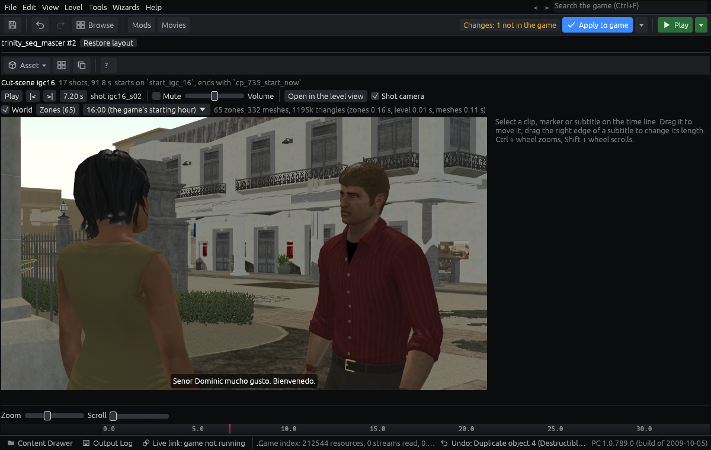
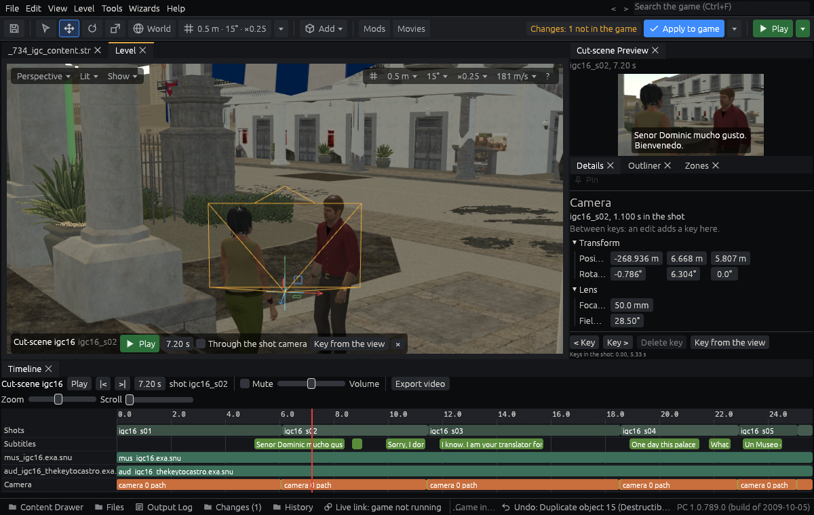

# 16. Ролики на движке

Внутриигровые ролики (прибытие в Гавану, «Добро пожаловать в Майами» и
другие) — не видеофайлы, а последовательности команд движка: где стоит
камера, кто из актёров какую анимацию играет, когда показать субтитр и
какое сообщение послать миссии. Тулкит показывает такой ролик на шкале
времени, проигрывает его в 3D и позволяет править. Формат описан в
[`docs/formats/cutscenes.md`](../formats/cutscenes.md).

## 15.1 Где лежат ролики

Ролик живёт в «папочном» потоке задания, например у первого ролика игры:

```
gf2/cuba/global/objectives/cp_010_030_mission_1/cp_009/cp_009_hotel_interior_folderstream
```

Его кадры — ресурсы `trinity_seq_master` этого потока, по одному на кадр
(`igc01_s01`, `igc01_s02a` …). Список всех роликов игры:

```sh
doctor-toolkit cutscene list "$GAME"
```

## 15.2 Монтажный стол в редакторе

Откройте любой ресурс `trinity_seq_master` (в потоке, поиском
`type:trinity_seq_master` или из палитры команд). Вид **Cut-scene**
показывает весь ролик, к которому относится кадр:

- **Шкала времени** внизу: кадры, субтитры и звуковая дорожка, камера (путь
  и поле зрения), эффекты, текстовые команды (сообщения миссии, время
  суток, тени), затемнения и по строке на каждого актёра с его клипами.
  Щелчок по линейке или пустому месту ставит курсор воспроизведения;
  **Ctrl + колесо** — масштаб, **Shift + колесо** — прокрутка; строки
  актёров сворачиваются заголовком **Actors**.
- **Просмотр** слева вверху: ролик в момент курсора. **Shot camera** —
  смотреть через камеру кадра; перетаскивание мышью переключает на
  свободную камеру (вращение, сдвиг правой кнопкой, колесо). **Load
  characters** собирает актёров из баз персонажей и ставит их в позу
  клипа (в первый раз читает индекс игры и все материалы — несколько
  секунд). Реквизит без базы персонажей показан крестиком (с миром — своим
  мешем), путь камеры — голубой линией, сама камера при свободном
  просмотре — красной пирамидой. Субтитр в момент курсора выводится поверх
  картинки.
- **Мир** вокруг ролика (строка под кнопками, этап 61) — см. ниже.
- **Play** проигрывает ролик со звуком, **|<** и **>|** переходят к
  началу кадра и к следующему кадру.
- **Инспектор** справа: свойства выбранного элемента.

### Мир вокруг ролика



Ролик идёт в мировых координатах уровня, поэтому просмотр показывает
его там, где он идёт в игре: зоны города вокруг пути камеры и актёров,
свет и небо времени суток, реквизит кадров.

- **World** включает и выключает мир (выключено — только актёры на тёмном
  фоне). Зоны выбираются и грузятся в фоне сразу на весь ролик, когда
  ролик открыт: переход по шкале и **Play** уже не ждут загрузки. Рядом —
  ход загрузки и итог: число зон, мешей, треугольников и время (выбор зон
  0,2–1 с, меши — доли секунды, если индекс игры уже построен). Меши
  общие с видом уровня: открытая там зона второй раз не грузится.
- **Zones (N)** — какие зоны показаны. Автоматически выбираются зоны
  `high` и `medium` вокруг пути, интерьер, в котором стоят актёры (из
  вариантов одного интерьера — основной), зоны задания у пути, небо,
  океан и папочный поток ролика. В списке зоны отмечены видом
  (`high`, `medium`, `interior`, `mission` …), расстоянием до пути и
  меткой `auto`; если выбор ошибся (например, лишний автомобиль или
  интерьер из другого задания), снимите флажок или добавьте зону и
  нажмите **Load**; **Automatic** возвращает автоматический выбор.
- **Время суток** (список рядом): по умолчанию — из ролика (команды
  `changeTime`, `changeApparentTime`; `restoreTimeState` возвращает время
  задания), иначе час, который ставит задание (`SetTimeOfDay`), иначе 16:00;
  в скобках — откуда оно взято. Можно выбрать час вручную. От времени
  зависят направление и цвет солнца (луны), окружающий свет, цвет неба и
  дымка вдали.
- Камера кадра показывает ровно то, что видно в игре (фокусное расстояние
  объектива, формат 16:9). Актёры стоят и двигаются там же, где в игре.
- Не рисуются: тени (`setShadowRanges` только показан на шкале), частицы и
  эффекты (`*.vfx`), постобработка (глубина резкости), фонари и неон.
  Сравнение с кадрами игры — `docs/formats/cutscenes.md` §9.4.
- Во время **Play** рядом показано число кадров в секунду (у `igc16` с
  65 зонами — около 35 к/с в окне на виртуальном экране Xvfb).

### Звук

При **Play** звучат все звуковые дорожки ролика: речь и эффекты
(`aud_*.snu`, 5.1, сводится в стерео) и музыка (`mus_*.snu`). Музыка
начинается там, где её запускает ролик: текстовая команда кадра шлёт
сообщение (`music_igc06_01`), а звуковой скрипт игры по нему включает
музыку со своей громкостью. Дорожки на шкале стоят на своём месте;
инспектор дорожки пишет, когда и каким сообщением она начинается и с
какой громкостью. Музыку, которую включает не ролик, а миссия (у `igc17`),
тулкит показывает серой и не играет.

- Время ведёт звук: курсор следует за тем, что слышно, без расхождения.
  Перемотка, **|<**, **>|**, щелчок по шкале и поле времени во время
  воспроизведения переводят звук на новое место; конец ролика
  останавливает и звук.
- Первое нажатие **Play** декодирует звук (доля секунды, рядом с кнопками
  крутится индикатор **Decoding the sound…**); курсор ждёт, пока звук
  готов, интерфейс при этом не замирает.
- **Mute** выключает звук (курсор по-прежнему идёт по звуку), ползунок
  **Volume** — общая громкость от 0 до 200 %.
- Звук есть в выпусках и в обычной сборке из исходников (раздел
  [1.3](01-install.md#13-сборка-из-исходников)). Без устройства вывода, у
  ролика без звука или в сборке без звука (`--no-default-features`)
  **Play** идёт по таймеру кадров, как раньше; причина пишется рядом с
  ползунком.

## 15.3 Что можно править

| Что | Как | Куда пишется |
|---|---|---|
| Время команды (клип, сообщение, эффект, затемнение, путь камеры) | перетащить на шкале или задать **Time in the shot** и **Apply** | кадр (`trinity_seq_master`) |
| Клип актёра | **Clip** в инспекторе — любой клип банков этого кадра | кадр |
| Ключи камеры | таблицы x, y, z, поворотов и поля зрения: время, значение, касательные | кадр |
| Текстовая команда | вид и текст (`setShadowRanges 2.0 28.0 75.0 0.0`, имя сообщения) | кадр |
| Затемнение, состояние эффекта, положение актёра | поля инспектора | кадр |
| Субтитр | перетащить; правый край — длина; или **Start**/**Length** в инспекторе | звук ролика в `.viv` (накладной архив) |

Каждое изменение — одна операция рабочего пространства: **Ctrl+Z** и
**Ctrl+Shift+Z** отменяют и возвращают, вкладка **Changes** показывает
изменённые кадры и файлы, **Apply to game** записывает их в игру (раздел 5).
Текст субтитра правится в таблице строк (`lh2`) папочного потока — вид
**Text**.

Команды движка двигаются внутри своего кадра: другие команды кадра
сохраняют своё время. Перенос дальше конца кадра удлиняет список команд,
но не кадр (длительность кадра задаёт поле заголовка; править его можно
через JSON).

## 15.3a Ролик в виде уровня (этап 62)



Ролик можно править прямо в виде уровня, как в Unreal Engine Sequencer:
поверх мира стоят актёры и камеры кадров, гизмо двигает их, ключи
ставятся на курсоре времени.

**Открыть.** Кнопка **Open in the level view** на вкладке ролика, пункт
того же имени в меню **Asset ▾** и в контекстном меню ярлыка вкладки
кадра, в контекстном меню кадра (`trinity_seq_master`) в Content
Browser. Вид уровня (открытая вкладка или новая) грузит зоны ролика — те
же, что выбирает просмотр (§15.2, «Мир вокруг ролика»), — и ставит свою
камеру туда, где камера кадра. Если в раскладке нет панели шкалы,
включается готовая раскладка **Cinematics**: вид, под ним **Timeline**,
справа **Cut-scene Preview** над **Details** (за ней Outliner и Zones).
Как любую раскладку, её можно перестроить: шкала может быть ящиком
(правый щелчок по вкладке → Make drawer), Preview — закрыта или
перенесена. View → **Timeline panel** (Ctrl+8) и **Cut-scene Preview
panel** (Ctrl+9) показывают и прячут их.

**Что видно в виде.**

- Актёры кадра на курсоре — в позе своего клипа (кнопка **Load
  characters** на полосе ролика внизу вида собирает персонажей), без
  персонажей — скелет или крестик.
- Камера кадра — пирамида с треугольником над верхним краем кадра;
  выбранная — янтарная.
- Пути камер всех кадров: кадр на курсоре — голубой, остальные —
  тёмные; точки — ключи камеры этого кадра (ключ на курсоре — белый).
- У выбранного актёра — его путь (ключи `0x206`) жёлтым.

**Полоса ролика** внизу вида: имя и кадр, **Play** (проигрывает ролик:
актёры и камера движутся, звучит звук ролика), поле времени, **Through
the shot camera** — вид смотрит через камеру кадра (движение камеры вида
выключает это; у вида нет крена — точную картинку 16:9 показывает панель
Cut-scene Preview), **Load characters**, **Key from the view**, «×» —
убрать ролик из вида.

**Выбор.** Щелчок по камере (пирамиде) или актёру в виде, или по строке
ветки **Cut-scene** вверху Outliner (камера и актёры кадра на курсоре;
• — ключ на курсоре; двойной щелчок — подлететь). F подлетает к
выбранному, Esc снимает выбор.

**Правка гизмо.** W — сдвиг, E — поворот (R у ролика тоже сдвигает:
масштаба у камеры и актёров нет), оси мира или объекта, привязка — как у
объектов уровня. Отпускание гизмо пишет **ключ на курсоре времени**:
если курсор на ключе (в пределах полукадра, 1/60 с), меняется он, иначе
добавляется новый. У камеры новый ключ ставится во все шесть кривых
(x, y, z, поворот x, y, z) с наклоном кривой в этой точке, так что путь
вокруг сохраняет форму; углы остаются рядом с прежними (без скачков на
360°). У актёра сдвиг пишет ключ положения, поворот — ключ поворота
(новый ключ положения сохраняет поворот этого места). Актёр без ключей
положения в кадре получает команду `0x206` там, где он создан.

**Details** выбранной камеры или актёра: кадр и время в нём, «На ключе» /
«Между ключами», **Transform** — положение и поворот (градусы) на
курсоре; у камеры — **Lens**: фокусное расстояние в мм и поле зрения в
градусах (вертикальное, кадра 16:9; правится любое из двух). Отпускание
поля пишет ключ так же, как гизмо. Кнопки: **< Key** и **Key >** —
курсор к соседнему ключу, **Delete key** (и Delete в виде) — удалить
ключи на курсоре (последний ключ кривой остаётся), **Key from the view**
(и Level → Cut-scene: camera key from the view) — поставить камеру кадра
на курсоре туда, куда смотрит камера вида: положение, направление и поле
зрения. Внизу — список ключей кадра.

Каждая правка — одна операция рабочего пространства (Ctrl+Z, панель
History, **Apply to game**): кадр записывается тем же писателем, что и
правки вкладки ролика.

**Шкала времени (Timeline)** — та же шкала, что во вкладке ролика:
кадры, субтитры, звук, камера, команды, актёры; Play, |<, >|, поле
времени, звук. Перетаскивание команд и субтитров правит ролик так же,
как во вкладке. Курсор общий: вид уровня, Timeline, Preview и открытая
вкладка этого ролика показывают один момент; Play и перемотка на вкладке
управляют им же.

**Cut-scene Preview** — картинка камеры кадра на курсоре в кадре 16:9 с
субтитром и миром (как просмотр вкладки): видно результат, пока камера
правится в свободном виде.

### Выгрузка в видео

**Export video** на панели Timeline: размер (по умолчанию 1280×720),
кадров в секунду (30), «только кадр на курсоре» или весь ролик,
персонажи; **Save as…** — файл `.vp6` (ролик в формате игры: свой кодер
VP6 и звук ролика, сведённый в 48 кГц стерео), `.mp4` (через ffmpeg,
H.264 и AAC; если ffmpeg нет — сказано в сообщении) или имя без
расширения — папка PNG-кадров. Рендер идёт в фоне (рядом — «Rendering N /
M»), картинка — как в панели Cut-scene Preview: мир, свет и небо времени
суток, актёры; субтитры в видео не впечатываются (игра выводит их сама).

Из командной строки:

```sh
doctor-toolkit cutscene render "$GAME" $F --shot igc16_s02 --characters \
    -o s02.vp6 --mp4 s02.mp4 --png-dir frames
```

`cutscene render` запускает `doctor-toolkit-gui` (рядом с программой или
`$DOCTOR_TOOLKIT_GUI`) без окна; нужна видеокарта (wgpu). Ключи:
`--width`, `--height`, `--fps` (29.97 — NTSC), `--from`/`--to` (секунды
ролика; по умолчанию — кадр `--shot` или весь ролик), `--no-world`,
`--characters`, `--hour`, `--no-sound`, `--workspace-dir`. Весь `igc16`
(91,8 с, 2754 кадра 1280×720) — около 86 с на RTX 4070: рендер ~96 к/с,
остальное — кодер VP6 (55 МиБ) и ffmpeg (24 МиБ).

## 15.4 Командная строка

```sh
F=gf2/cuba/global/objectives/cp_010_030_mission_1/cp_009/cp_009_hotel_interior_folderstream
doctor-toolkit cutscene show "$GAME" $F                          # шкала времени текстом
doctor-toolkit cutscene show "$GAME" $F --shot igc01_s03          # один кадр (номера команд)
doctor-toolkit cutscene move "$GAME" $F --shot igc01_s03 --command 51 --time 3.0
doctor-toolkit cutscene clip "$GAME" $F --shot igc01_s03 --actor igc01_roth \
    --clip igc01_waiter_igc01_s03_shot03
doctor-toolkit cutscene show "$GAME" $F --shot igc01_s03 --time 1.5 # где камера и актёры в этот момент
doctor-toolkit cutscene camera "$GAME" $F --shot igc01_s03 --time 1.5 \
    --position=-12.4,1.7,3.0 --rotation=-5,90,0 --focal 35           # ключ камеры в момент
doctor-toolkit cutscene camera "$GAME" $F --shot igc01_s03 --offset=0,1.5,0 --focal 28  # весь кадр
doctor-toolkit cutscene camera "$GAME" $F --shot igc01_s03 --time 1.5 --delete-key
doctor-toolkit cutscene actor "$GAME" $F --shot igc01_s03 --actor igc01_roth --offset=-1.2,0,0
doctor-toolkit cutscene actor "$GAME" $F --shot igc01_s03 --actor igc01_roth --time 2 \
    --position=-11,0,4 --rotation=0,180,0
doctor-toolkit cutscene command "$GAME" $F --shot igc01_s03 --command 51 --set seconds=2.5
doctor-toolkit cutscene subtitle "$GAME" $F --line 0 --start 2500 --duration 6000
doctor-toolkit cutscene export "$GAME" $F --shot igc01_s03 -o s03.json   # JSON для правки
doctor-toolkit cutscene import "$GAME" $F --shot igc01_s03 s03.json
doctor-toolkit cutscene gltf "$GAME" $F --shot igc01_s03 -o s03.glb      # камера и актёры
doctor-toolkit cutscene render "$GAME" $F --shot igc01_s03 -o s03.vp6    # видео с миром (§15.3a)
```

Правки пишутся в рабочее пространство; `--direct` сразу записывает их в
игру, `--workspace-dir` выбирает другое пространство.

`camera` и `actor` (этап 104) — те же правки ключей, что поля Details и
гизмо в виде уровня (§15.3a). С `--time` меняется ключ в этот момент
кадра (нет ключа — добавляется на пути; не заданное берётся с пути),
`--delete-key` убирает ключи в этот момент. Без `--time` меняется весь
кадр: `--offset` и `--turn` сдвигают каждый ключ пути камеры (у актёра —
место создания и все ключи), `--focal` (мм) или `--fov` (градусы по
вертикали кадра 16:9) ставят объектив на каждый ключ. Отрицательные числа
пишутся через `=`: `--offset=-1.2,0,0`. `command --set ПОЛЕ=ЗНАЧЕНИЕ`
меняет поле команды (как она записана в JSON кадра: `text`, `seconds`,
`color`, `speed`, `state`, …), `--time` заодно переносит её.

**Время субтитра и размер мода.** `cutscene subtitle` печатает размер
звукового файла: время субтитров лежит в его заголовке, а файл архива
заменяется целиком, поэтому мод с такой правкой несёт весь звук ролика
(у `igc16` — 10,5 МБ). Сборка мода напоминает об этом строкой `note:`.
Текст субтитра (глава 4, мастер «Править тексты») в мод идёт одной строкой.

Те же действия есть у ИИ-помощника (глава 22): `cutscenes`,
`cutscene_camera`, `cutscene_actor`, `cutscene_command`, `edit_subtitle`.

## 15.5 Экспорт в glTF

`cutscene gltf` (без `--shot` — весь ролик, `--index N` — отдельные кадры)
пишет одну анимацию `cutscene`: камеру с её путём и актёров с их клипами,
каждый — на своём месте шкалы. Вне своего кадра актёр сжат в точку. В
Blender: File → Import → glTF, затем выбрать камеру `camera` активной
(Ctrl+0) и проиграть. `--skeletons` пишет скелеты без персонажей (файл
в разы меньше).
