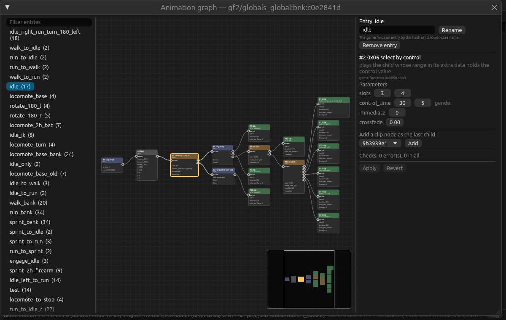

# 24. Граф анимации

Анимации персонажей лежат в банках `bnk` (`docs/formats/characters.md`
§6). Игра просит у банка не клип, а **вход** по имени — `idle`,
`locomote_base`, `walk_to_idle`. Вход — дерево **узлов**: последовательности,
случайный выбор с весами, выбор и смешивание по переменным игры (скорость
стика, угол поворота, пол персонажа), сложение поз; в листьях — клипы.
Формат и смысл всех типов узлов — `docs/formats/anim-graph.md`.



## Открыть граф

Выберите банк `bnk` (например, `gf2/globals_global`, ресурс
`bnk:c0e2841d` — движения игрока) и нажмите **Graph** в Details: банк
откроется вкладкой сразу на графе (во вкладке банка переключатель
**Clips / Graph** на полосе инструментов; Frame и F — к выбранному узлу):

- **слева** — входы банка с числом узлов и фильтром;
- **в середине** — дерево выбранного входа: корень слева, дети справа.
  Заголовок узла — его номер (слот) и что он делает, под ним — тип и клип,
  строки — параметры, строки со стрелкой `↳` — данные, которые читает
  родитель (вес ребёнка случайного выбора, диапазон ребёнка выбора по
  переменной). Колёсико — масштаб, перетаскивание пустого места — сдвиг;
  красный или жёлтый значок `!` — ошибка или предупреждение проверки;
- **в Details** — инспектор выбранного узла и проверка всего графа
  (если Details закрыта — справа от графа).

Например, вход `idle` играет: поправку ног → выбор по переменной `gender`
(мужской и женский варианты) → последовательность, где случайный выбор с
весами 4 и 2 решает, будет ли персонаж просто стоять (`idle`) или смотреть
на часы и переминаться (вложенный случайный выбор из шести клипов).

## Правка

Все правки сначала копятся во вкладке; **Apply** записывает новый банк в рабочее
пространство одной операцией (её отменяет **Undo**, в игру пишет **Apply
to game**), **Revert** возвращает граф как был.

- **Параметры** узла — поля инспектора: целые, дробные (`f32`) и пары
  чисел. У переменных игры рядом показано имя (`gender`, `turn angle`).
  Наведите курсор на имя поля — появится подсказка, что оно значит.
- **Вес** ребёнка случайного выбора и **диапазон** ребёнка выбора по
  переменной — в «Extra data for the parent» этого ребёнка. Поднимите вес
  клипа — игра будет выбирать его чаще.
- **Клип** узла клипа — выпадающий список; **Duration from the clip**
  ставит длительность по правилу игры (кадров × 2 тика у зацикленных
  клипов, (кадров − 1) × 2 у остальных) — без этого игра обрежет или
  растянет новый клип.
- **Добавить узел клипа** можно в последовательность, случайный выбор и
  выбор по переменной: выберите клип и нажмите **Add**. Новый узел получает
  длительность по клипу, вес 1 (в случайном выборе) или диапазон после
  последнего (в выборе по переменной).
- **Move up / Move down** меняют порядок детей, **Remove** (или Delete в
  графе) удаляет узел с поддеревом — только у тех узлов, где число детей
  не фиксировано, и если у родителя останется хоть один ребёнок.
- **Вход** можно переименовать (игра ищет вход по хэшу имени в нижнем
  регистре) или удалить (кнопку нужно нажать дважды).

Номера узлов (слоты) редактор раздаёт сам, как это делал экспортёр игры.
Новые узлы других типов редактор не создаёт: их функции в игре разобраны,
но параметры проверены только на тех сочетаниях, что есть в банках.

## Проверка

Справа внизу — итог проверки: **ошибки** (тип, которого нет в игре; не то
число детей; нет веса или диапазона у ребёнка; переменная вне таблицы игры;
клип вне банка; слот занят дважды; нулевой размах смешивания) и
**предупреждения** (длительность узла не по клипу, корень не
последовательность). С ошибками **Apply** недоступен. Щелчок по строке
выделяет узел. В банках игры ошибок нет; три предупреждения — узлы,
длительность которых игра задала не по правилу.

## Командная строка

```sh
# дерево входа с параметрами и проверкой
doctor-toolkit anim graph "$GAME" gf2/globals_global:bnk:c0e2841d --entry idle
# граф в JSON, правка в любом редакторе, запись обратно (одна операция)
doctor-toolkit anim graph "$GAME" gf2/globals_global:bnk:c0e2841d --json > graph.json
doctor-toolkit anim graph "$GAME" gf2/globals_global:bnk:c0e2841d --set graph.json
# типы узлов, их параметры и переменные игры
doctor-toolkit anim node-types
```

В JSON у каждого узла: `kind` (тип), `number` (слот; уберите его у всех
узлов — номера раздадутся заново), `params` и `extra` (слова по типу:
целое, дробное или пара `[младший, старший]`), `clip` (номер клипа в
банке), `children`. Поля `what` и `clip_name` — для чтения, при записи не
нужны. `--set` с ошибками проверки ничего не записывает.

Python: `dt.animation_graph(bytes)` — входы, проверки и число слотов;
`ws.set_animation_graph(key, {"entries": …})` — запись одной операцией
(`docs/python.md`).

## Импорт анимаций и перенацеливание

Импорт клипа (**Import clip…**, `anim import`) и чтение клипов из файлов
моделей используют одно перенацеливание (`docs/model-formats.md` §5).
`anim import --rest` выбирает, как свести позу покоя файла со скелетом
игры: `auto` (по умолчанию), `as-is` — файл сделан из скелета игры,
`axes` — те же кости с другими осями (FBX из Blender), `retarget` — другой
скелет. Итог импорта печатает применённый режим.

**FBX из Blender — только с мешем.** Если экспортировать в FBX одну
арматуру, Blender не пишет позу привязки, и анимация легла бы со сдвигом.
Такой файл не принимается: экспортируйте арматуру вместе с мешем,
привязанным к ней, или в glTF/USD. Файл без арматуры (суставов) тоже не
принимается.

## Что проверить в игре

Правка графа видна в игре (`docs/analysis/game-bench.md` §31.4): во
входе `idle` узел клипа `idle` с клипом `ambient_wrist_check_time` и весом
100 — игрок, стоя, смотрит на часы каждые ~10 с (без правки за 40 с — ни
разу). Остальные пункты плана:

1. В `gf2/globals_global:bnk:c0e2841d`, вход `idle`: поднять вес клипа
   `idle` (4 → 100) в случайном выборе — персонаж почти перестаёт смотреть
   на часы; поставить вес 0 — только вариации.
2. Там же добавить в случайный выбор узел клипа, например `run`, и
   нажать **Duration from the clip** — в стойке иногда играет бег на месте.
3. Вход `locomote_base`: поменять `min`/`range` смешивания по `pl stick
   speed` — переход от шага к бегу при другом наклоне стика.
4. Поменять множитель узла растяжения времени (тип 0x08) в
   `rotate_180_l` — разворот быстрее или медленнее.
5. Импорт FBX Blender с мешем (режим `axes`) — клип ложится без сдвига.
