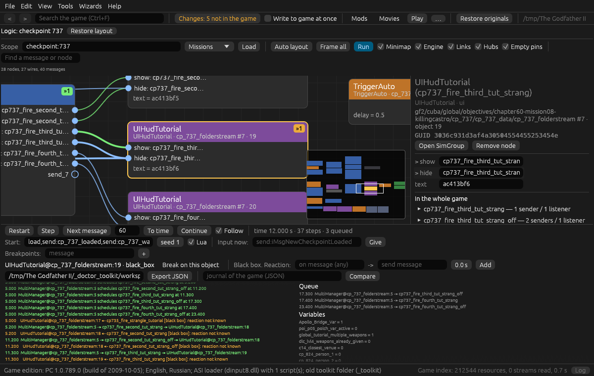

# 25. Прогон логики без игры

Граф логики (раздел 14) показывает, **кто кому может** послать сообщение.
Прогон показывает, **что произойдёт**: тулкит сам рассылает сообщения
между объектами миссии, ведёт игровое время, таймеры и переменные, запускает
Lua-скрипты — и записывает журнал «кто кому послал и когда». Игру
запускать не нужно: так удобно проверить свою правку логики до записи в
игру. Устройство и основания — `docs/logic-graph.md` §9.



## Что прогон знает и чего не знает

Для основных классов логики поведение взято из кода игры:
`MultiManager`, `MessageRelay`, `AndEventGate`, `OrEventGate`,
`TriggerAuto`, `TriggerRandom`, `VariableOperator`, `VariableSwitch`,
`VariableWatcher`, `MissionTimer`, `TestCurrentCheckpoint`, триггеры
(`TriggerBox` и другие с пакетом `TriggerBase`, `EnterExitTrigger`) и
`LuaAudioScript`.

Всё остальное — спавн, подсказки на экране, ролики, звук, сам
`Checkpoint` — **«чёрный ящик»**: сообщение до него доходит (это видно в
журнале и на графе оранжевым), но что он сделает в игре, прогон не
придумывает. Если вам нужно, чтобы цепочка шла дальше, задайте реакцию
вручную: «получив X, послать Y через D секунд».

Чего в прогоне нет: игрока в мире (вход в триггер вы задаёте сами),
позиций, времени суток, очков. Сообщения движка (`iMsgNewCheckpointLoaded`
и другие) тоже подаёте вы.

## Запуск в редакторе

1. Откройте граф логики (Tools → Logic graph, Ctrl+G) и область —
   например `checkpoint:737`.
2. Нажмите **Run** на панели вкладки. Внизу откроется панель прогона;
   прогон готов и начнётся с событий в поле **Start** (по умолчанию `load` —
   загрузка: скрипты с запуском при загрузке и сообщение
   `iMsgPostSpawnInitialize`, на которое срабатывают `TriggerAuto`).
3. Кнопки:
   - **Step** — один шаг: одна отправка или одна доставка сообщения (или
     переход игрового времени к следующему событию очереди);
   - **Next message** — до следующего отправленного сообщения;
   - **To time** — до игрового времени из поля слева (секунды);
   - **Continue** — пока есть что делать или до точки останова;
   - **Restart** — заново, с событиями из **Start** (точки останова
     остаются).
4. **Input now** подаёт событие сейчас, например `send:cp_737_loaded` или
   `enter:#19` (игрок вошёл в триггер №19 — номера показывает
   `logic-run --actors`; подойдут и имя объекта, и его GUID).

События: `load`, `send:СООБЩЕНИЕ`, `enter:ОБЪЕКТ`, `exit:ОБЪЕКТ`,
`var:ИМЯ=ЧИСЛО`, `checkpoint:НОМЕР` (для `TestCurrentCheckpoint`),
`wait:СЕКУНДЫ` (следующие — позже), `at:T:СОБЫТИЕ`; несколько — через `;`
или `,`.

## Что видно

- **На графе**: провода прошедших сообщений зелёные, ярко-зелёные — в
  последней команде; у узлов, получивших сообщения, значок `»N` (сколько
  раз), оранжевый — у «чёрного ящика»; `BP` — точка останова.
- **Журнал** слева внизу: время, кто послал, какое сообщение и кому;
  ниже — что сделал каждый получатель («sends …», «condition 1 of 3»,
  «reaction not known»). Щелчок по строке выделяет объект на графе; с
  флажком **Follow** выделяется объект, получивший последнее сообщение.
- Справа внизу — **очередь** (отложенные сообщения, таймеры) и
  **переменные** игры (знак `?` — переменной нет в словарях игры,
  значение 0 условное).

## Точки останова и ручные реакции

- **Breakpoints**: имя сообщения и `+` — прогон встанет перед его
  отправкой. Щелчок по точке в списке убирает её.
- Выделите узел: **Break on this object** — останов перед тем, как объект
  получит любое сообщение.
- У выделенного «чёрного ящика»: «на сообщение» (пусто — на любое),
  «послать сообщение», задержка, **Add**. У известных классов такая
  реакция добавляется к их собственной.

## Журнал и сравнение с игрой

**Export JSON** записывает журнал (по умолчанию в
`_doctor_toolkit/workspace/logic_runs/<область>.json`). **Compare**
сравнивает прогон с журналом сообщений, записанным в игре через живую связь
(раздел 11): совпавшие сообщения, сдвиг времени, сообщения только в
прогоне и только в игре, разница получателей. Формат журнала —
`docs/logic-graph.md` §9.5.

## Командная строка

```sh
doctor-toolkit logic-run GAME checkpoint:737 --actors          # объекты и их модели
doctor-toolkit logic-run GAME checkpoint:737 \
  -e "load; send:cp_737_loaded; send:cp_737_was_started; wait:5; enter:#19" --until 60
doctor-toolkit logic-run GAME mission:killingcastro --json -o run.json
doctor-toolkit logic-run GAME checkpoint:737 --break-message cp_739_start_now
doctor-toolkit logic-run GAME checkpoint:737 --reactions reactions.json --compare game.json
```

Без `-e` прогон начинается с `load`. `--until` — до игрового времени,
`--steps` — предел шагов, `--seed` — зерно случайного выбора
`TriggerRandom`, `--no-lua` — без скриптов, `--original` — без ваших правок.

Python: `dt.logic_run(game, "checkpoint:737", events=["load"], until=60)`
возвращает журнал, объекты, переменные и, с `compare=`, сравнение.

## Советы

- Начните с `--actors`: видно, какие объекты прогон понимает, а какие —
  «чёрные ящики», и какие сообщения они слушают.
- Миссия часто ждёт сообщений чекпоинта (`cp_NNN_loaded`,
  `cp_NNN_was_started`): их шлёт объект `Checkpoint` уровня, а не сама
  миссия, — подайте их событиями `send:`.
- Предупреждение о цикле значит: два объекта шлют друг другу сообщения без
  задержки — в игре это переполнило бы стек.
